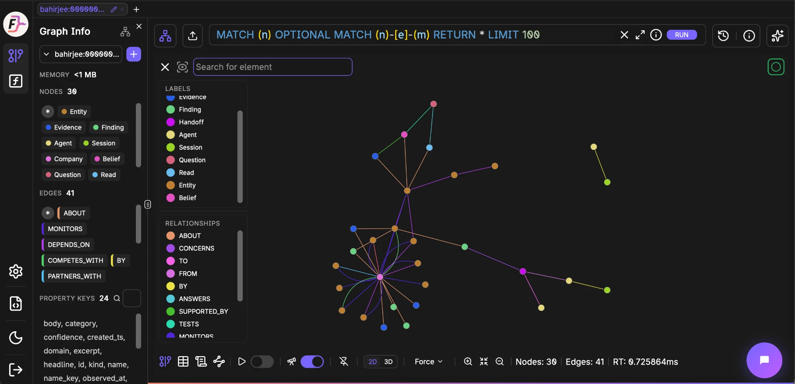
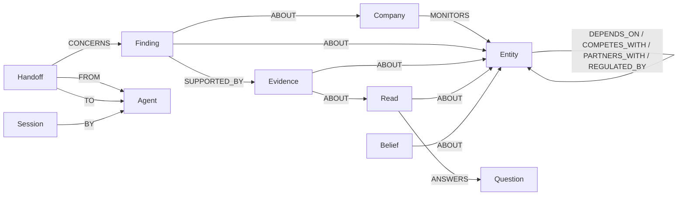

# Bahirjee: a shared memory graph for strategic-intelligence agents

Bahirjee watches a company's market for its founders: competitors, dependencies, regulators. Its
agents used to forget everything between runs. Now they share one **FalkorDB graph per tenant**.
They write down what they learn and what they hand to each other, and they answer questions by
traversing it. Every answer that comes from the graph shows the path it followed.

**Graph Hacks 2026 · Track: Agent Memory and Coordination**

| | |
| :--- | :--- |
| **Live app** | https://bahirjee-graph-memory.vercel.app/ (sign in with `admin@bahirjee.in`: no password, no email to click) |
| **Judge guide** | [docs/JUDGE_GUIDE.md](./docs/JUDGE_GUIDE.md): step-by-step checks in the live app, with screenshots |
| **Run it yourself** | [Graph only, no Supabase](#run-it-locally-graph-only-no-supabase): Docker, a Gemini key, and a seed script |
| **Cypher** | [The queries the product depends on](#the-cypher-the-product-depends-on), runnable copies in [queries.cypher](./docs/graph-hacks/queries.cypher) |



---

## The problem

Bahirjee runs a team of agents for each company it watches: a page **watcher**, a **triage** step, a
**pursuer** that follows up, a full analysis pipeline, and **Ask Bahirjee**, a Q&A agent on every
brief. Before this hackathon, none of them remembered anything:

- Every question re-searched the web, even ones answered the day before.
- No agent recorded what it had handed to which other agent, so *"who owns the pending ShipSwift
  work?"* had no answer.
- The questions founders care about most are about connections, and a store of rows can't answer
  them: *what breaks if AWS goes down?*, *how are we exposed to the state power grid?*, *what is
  load-bearing for us?*

## What the graph does

Each capability below **is** a graph traversal or a graph algorithm. None of them has a non-graph
version anywhere in the codebase, so removing FalkorDB removes the capability.

| Ask Bahirjee | What runs in FalkorDB | Without FalkorDB |
| :--- | :--- | :--- |
| "What did we find about ShipSwift last time?" | `recall`: 1–2 hop traversal over `ABOUT / SUPPORTED_BY / ANSWERS` | Re-researched from scratch |
| "What breaks if AWS goes down?" | `blast_radius`: variable-length dependency traversal, depth 1–4 | Gone |
| "How is Acme Freight connected to State PowerGrid?" | `path_between`: `algo.SPpaths` shortest paths | Gone |
| "What is load-bearing for us?" | `load_bearing`: `algo.pageRank` | Gone |
| "Who picks up the ShipSwift work next?" | `next_agent`: pending `Handoff` → `Agent` traversal | Gone: handoffs were never recorded |
| Change feed | `recent_changes` and `/api/graph activity` | Gone |

An answer from the graph ends with a provenance line naming the tool, the path and when it was
remembered, for example:

```
[via memory graph — tool: blast_radius · path: AWS → Kubernetes → Acme Freight · memory as of 2026-10-18]
```

**The removal test is built in.** With `MEMORY_GRAPH_ENABLED=0`, every graph read returns
`graph_unavailable` without running a query, and every write is skipped. Bahirjee keeps running,
but only as the old product: Ask Bahirjee falls back to company context and then web search, with no
memory. Recall, impact, paths, ranking and handoff routing all stop.

### Memory that lasts across sessions

The graph is written from three places. All of them are idempotent `MERGE`s and fail open: if
FalkorDB is down, the product carries on.

- **Every completed analysis run** (`lib/_intelligenceWorker.js` → `lib/_graphRunWriter.js`). After
  the report is saved, the run writes the `Company`, an `Entity` per tracked entity
  (`Company-[:MONITORS]->Entity`), a `Session` (`kind: 'analysis_run'`), and a `Finding` per
  published signal, `ABOUT` its entity and `SUPPORTED_BY` an `Evidence` node for its source URL.
  Ids come from the run id plus a hash of the signal, so a retried worker re-merges instead of
  duplicating. The writes are capped by `GRAPH_RUN_WRITE_BUDGET_MS` (default 8000) and never delay
  the report.
- **The daily agent ladder** (`lib/handlers/cron-daily.js`): Sessions, Findings and Evidence for each
  important page change, Handoffs between the agents, and Reads that answer Questions.
- **Ask Bahirjee write-back** (`/api/graph record_finding`). When the graph can't answer and
  Bahirjee answers from web search instead, that answer is written back as a `Finding` linked to the
  entities the question named. The next session recalls it instead of searching again.

### Shared state between agents

Handoffs are nodes: `(Handoff {status})-[:FROM]->(Agent)`, `-[:TO]->(Agent)` and
`-[:CONCERNS]->(Finding)`. The daily ladder writes `watcher → triage → pursuer` handoffs, and the
triage → pursuer handoff is marked `done` when the pursuit completes. `next_agent` and the activity
feed read that shared state.

**What coordination means today, honestly:** the three rungs still run in sequence inside one cron
invocation, so the pursuer does not yet *choose its work* by querying the graph for pending
handoffs. That is the next step, and this submission doesn't claim it.

### Separate memory per tenant

Each tenant gets its own named graph, **`bahirjee:{client_id}`**. The name is built in exactly one
place (`graphNameFor` in `lib/_graph.js`), from a UUID-checked `client_id` that `/api/graph` reads
from the signed-in user's profile. A request body can never name a graph, so the graph boundary is
the tenant boundary.

### The model picks tools; it never writes Cypher

[lib/_graphAgent.js](./lib/_graphAgent.js) runs a Reason → Tool → Observe loop, capped at
`MEMORY_GRAPH_MAX_STEPS` (4). On each step, one schema-constrained Gemini light-tier call returns
`{done, tool, args, answer}`.

- Questions about earlier work ("last time", "earlier") are **forced to run `recall` first**.
- Tool names are matched against the fixed list of six. Entity arguments are re-checked against
  the entities found in the question, so an argument the model made up is replaced, never trusted.
- **The outcome comes from what the tools returned**, not from what the model says:
  `answered_with_path`, `answered_from_memory`, `unknown_entity` (no query ran), `not_in_graph`
  (the entities are known but not connected, which describes our coverage and is not a claim that
  they're unrelated), or `graph_unavailable`.
- A final answer that names an entity no tool returned is **rejected** and replaced with a
  description of the real top path.

---

## Try it

### In the live app

Open https://bahirjee-graph-memory.vercel.app/ and sign in with `admin@bahirjee.in`. The
[judge guide](./docs/JUDGE_GUIDE.md) walks through four checks with screenshots:

1. **Open an analysis that already ran**: the desk, then **Open full read**.
2. **Ask the memory graph** from the **Ask Bahirjee** box, for example `What breaks if AWS goes down?`,
   and look for the provenance line.
3. **Add a new memory and recall it**: ask something the graph can't answer yet, start a new
   session, and ask what was found last time. The second answer comes from memory.
4. **Run a new analysis** on any public company website. When it completes, its findings are written
   to the graph.

The demo account is shared by every judge, and an analysis makes real search and LLM calls, so
please start one or two at most.

### Run it locally (graph only, no Supabase)

Requirements: Node 20+, Docker (or a FalkorDB Cloud instance), and a Gemini API key.

```bash
git clone https://github.com/saurabhjambure-pixel/bahirjee-graph-memory.git
cd bahirjee-graph-memory
npm install

# 1. FalkorDB: local Docker (or FalkorDB Cloud; the free tier has no TLS, so use falkor://, not falkors://)
docker run -d -p 6379:6379 -p 3000:3000 falkordb/falkordb

# 2. A minimal .env for the graph layer
cat > .env <<'EOF'
FALKORDB_URL=falkor://localhost:6379
# FALKORDB_USERNAME=…   FALKORDB_PASSWORD=…   (Cloud only)
MEMORY_GRAPH_ENABLED=1
MEMORY_GRAPH_MAX_STEPS=4
GEMINI_API_KEY=your-gemini-key
INTERNAL_API_KEY=any-long-random-string
EOF

# 3. Seed the synthetic tenant, then run the offline test matrix
node --env-file=.env scripts/graph-seed.mjs
npm run test:graph                      # 19 checks, fake FalkorDB client, no network

# 4. Ask the graph (the same loop /api/graph runs; prints outcome, tool trace and paths)
node --env-file=.env scripts/graph-ask.mjs "What breaks if AWS goes down?"
node --env-file=.env scripts/graph-ask.mjs "How is Acme Freight connected to State PowerGrid?"
node --env-file=.env scripts/graph-ask.mjs "What is load-bearing for us?"
node --env-file=.env scripts/graph-ask.mjs "Who picks up the ShipSwift work next?"
node --env-file=.env scripts/graph-ask.mjs "What did we find about ShipSwift last time?"
node --env-file=.env scripts/graph-ask.mjs "What do we know about Zorblax?"   # unknown_entity, no query runs

# 5. Removal test: the graph capabilities disappear and say so
MEMORY_GRAPH_ENABLED=0 node --env-file=.env scripts/graph-ask.mjs "What breaks if AWS goes down?"
```

Then open FalkorDB Browser at http://localhost:3000, select graph
`bahirjee:00000000-0000-4000-8000-00000000000d`, and paste the queries from
[docs/graph-hacks/queries.cypher](./docs/graph-hacks/queries.cypher) one at a time.

---

## Graph data model

One named graph per tenant, `bahirjee:{client_id}`.



| Label | Id format | Key properties |
| :--- | :--- | :--- |
| `Company` | `co:{client_id}` | `name`, `name_key`, `domain` |
| `Entity` | `ent:{tracked_entity id}` | `name`, `name_key` (lowercased; the lookup key), `category` |
| `Agent` | `agt:{name}` | `name` (`watcher` / `triage` / `pursuer`), `role` |
| `Session` | `sess:daily:{client}:{date}` / `sess:run:{run_id}` | `kind` (`daily_ladder` / `analysis_run`), `started_ts`; runs add `run_id`, `report_id` |
| `Finding` | `fnd:{seed}` (runs: `fnd:run:{run_id}:{hash}`) | `headline`, `url`, `ts`, `provenance` |
| `Evidence` | `ev:{…}` | `url`, `ts`, `provenance` (`source_watch` / `analysis_run` / `read` / `ask_bahirjee`) |
| `Read` | `read:{read id}` | `headline`, `confidence`, `ts` |
| `Question` | `q:{question id}` | `question`, `watch_for`, `status` |
| `Handoff` | `ho:{seed}` | `status` (`pending` / `done`), `reason`, `created_ts`, `completed_ts` |
| `Belief` | `belief:{…}` | `statement`, `confidence` (seeded only; no live writer yet) |

Every node also carries `tenant` and a unique `id`. `ensureSchema()` creates a unique constraint on
`id` and an index for each label.

## The Cypher the product depends on

The model never writes Cypher. It picks one of six tools and fills in typed arguments, and these
human-reviewed, parameterised queries run. The full source is in
[lib/_graphTools.js](./lib/_graphTools.js). The only value spliced into a query string is `depth`,
because Cypher can't parameterise variable-length bounds; it is checked to be an integer no larger
than `MAX_DEPTH = 4` first. Relationship lists are constants.

**Entity gate.** Runs before every tool. If the entity isn't found, the tool returns
`unknown_entity` and *no other query runs*:
```cypher
MATCH (e) WHERE (e:Entity OR e:Company) AND e.name_key = $key RETURN e LIMIT 2
```

**`recall(entity)`:** earlier findings, reads, evidence and questions:
```cypher
MATCH (e {id: $id})
MATCH p = (x)-[:ABOUT|SUPPORTED_BY|CONTRADICTED_BY|TESTS|ANSWERS*1..2]-(e)
WHERE x:Finding OR x:Read OR x:Belief OR x:Evidence OR x:Question
RETURN x, p LIMIT $limit
```

**`blast_radius(entity, depth)`:** complete dependency paths, depth 1–4:
```cypher
MATCH (e {id: $id})
MATCH p = (e)-[:DEPENDS_ON|PARTNERS_WITH|COMPETES_WITH|MONITORS|REGULATED_BY*1..{depth}]-(x)
RETURN p LIMIT $limit
```

**`path_between(a, b)`:** FalkorDB's shortest-paths algorithm:
```cypher
MATCH (s {id: $a}), (t {id: $b})
CALL algo.SPpaths({sourceNode: s, targetNode: t,
                   relTypes: ['DEPENDS_ON','PARTNERS_WITH','COMPETES_WITH','MONITORS','REGULATED_BY'],
                   undirected: true, pathCount: 3, maxLen: 6})
YIELD path RETURN path LIMIT $limit
```

**`load_bearing(limit)`:** PageRank over the tenant graph:
```cypher
CALL algo.pageRank(NULL, NULL) YIELD node, score
WITH node, score WHERE node:Entity
RETURN node, score ORDER BY score DESC LIMIT $limit
```

**`next_agent(entity)`:** coordination state:
```cypher
MATCH (e {id: $id})<-[:ABOUT]-(work)<-[:CONCERNS]-(h:Handoff {status: 'pending'})
MATCH (h)-[:FROM]->(fromAgt:Agent), (h)-[:TO]->(toAgt:Agent)
RETURN h, work, fromAgt, toAgt LIMIT 3
```

**`recent_changes(entity, since)`:**
```cypher
MATCH (e {id: $id})<-[:ABOUT]-(n)
WHERE (n:Finding OR n:Evidence OR n:Read)
  AND coalesce(n.ts, n.observed_at, n.created_ts, 0) >= $since
RETURN n LIMIT $limit
```

**Writes** ([lib/_graphWriter.js](./lib/_graphWriter.js)) are idempotent `MERGE`s. The label and
relationship type come from fixed allowlists, never from input:
```cypher
MERGE (n:{Label} {id: $id}) SET n += $props
MATCH (a {id: $a}), (b {id: $b}) MERGE (a)-[r:{REL}]->(b) SET r += $props
MATCH (h:Handoff {id: $id}) SET h.status = 'done', h.completed_ts = $ts
```

**Activity feed** (`POST /api/graph` with `action: 'activity'`, in
[lib/handlers/graph.js](./lib/handlers/graph.js)): the latest work the agents wrote, newest first:
```cypher
MATCH (n)
WHERE n:Handoff OR n:Finding OR n:Read OR n:Session
RETURN n ORDER BY coalesce(n.ts, n.created_ts, n.started_ts, n.observed_at, 0) DESC
LIMIT $limit
```

**Schema bootstrap** (`ensureSchema()` in [lib/_graph.js](./lib/_graph.js)), run once per tenant
graph. A unique `id` constraint is created for each of the ten labels with the client's
`constraintCreate('UNIQUE', 'NODE', label, 'id')`. That is a FalkorDB module command
(`GRAPH.CONSTRAINT CREATE`), not Cypher. The indexes are Cypher:
```cypher
CREATE INDEX FOR (n:{Label}) ON (n.id)          -- for each of the ten labels
CREATE INDEX FOR (e:Entity) ON (e.name_key)     -- backs the entity gate
```
An index or constraint that already exists counts as success, so bootstrap is safe to repeat.

**Try every query yourself:** [docs/graph-hacks/queries.cypher](./docs/graph-hacks/queries.cypher)
has all of the queries above with their parameters filled in from the seed tenant.

---

## How it was verified

- **`npm run test:graph`: 19 offline checks** against a fake FalkorDB client. They cover tenant
  naming and the UUID gate, the disabled path running zero queries, unknown entities running no query,
  recall, blast radius at depth 1 vs 4, real `SPpaths` routes, `not_in_graph` for disconnected
  entities, PageRank ranking, Q&A write-back landing only in its own tenant's graph, rejection of
  made-up entities, the 4-step cap, forced recall-first, and the analysis-run writer.
- **Live, against FalkorDB Cloud and real Gemini:** all six tools, the write-back → recall round trip
  in a new session, and the full agent loop on all five demo questions. The results and the bugs
  that only live testing found are in [docs/graph-hacks/progress-log.md](./docs/graph-hacks/progress-log.md),
  for example: FalkorDB constraints are a module command, not Cypher; a MERGE+SET that overwrote the
  company's name; and the light model "thinking aloud" inside the tool name.

## What was built during the hackathon

Bahirjee itself (the intelligence pipeline, Supabase schema and React app) existed before 15 Oct
2026, and it is the host this submission plugs into. **Everything graph-related was written during
the hackathon, on 17–18 Oct 2026**: about 2,250 lines of new graph code and tests, plus the
integration changes below. The first four commits from the private development repository are
squashed here into `b0bb208`. The runnable Cypher docs followed in `114d5f6`, and the analysis-run
writer in `81ef649`. The design plan and the implementation log are in
[docs/graph-hacks/](./docs/graph-hacks/).

| New | Changed (integration points) |
| :--- | :--- |
| `lib/_graph.js`: connection, per-tenant graph naming, schema, fail-closed reads | `lib/handlers/cron-daily.js`: the daily ladder writes Sessions, Findings, Evidence, Handoffs, Reads |
| `lib/_graphTools.js`: the six fixed tools and their Cypher | `lib/handlers/gemini.js`: `graphAgentStep` (light-tier, schema-constrained tool picker) |
| `lib/_graphWriter.js`: allowlisted MERGE writers | `src/services/promptUtils.js`: the tool-picker prompt |
| `lib/_graphRunWriter.js`: a completed analysis run → Company, Entities, Session, Findings | `lib/_intelligenceWorker.js`: every completed run is written to the graph |
| `lib/_graphAgent.js`: Reason → Tool → Observe loop, grounding check | `src/components/IntelligenceDashboard.jsx`: Ask Bahirjee asks the graph first |
| `lib/handlers/graph.js`: `/api/graph` (`ask`, `activity`, `record_finding`) | `src/services/intelligenceService.js`: web answers are written back |
| `src/services/graphMemory.js`: browser client and provenance line | `api/router.js`: route registration |
| `scripts/graph-seed.mjs`, `scripts/graph-ask.mjs`, `scripts/graph-roundtrip.test.mjs` | `package.json`: `falkordb@6.8.0`, `test:graph` |

## Data used

- **The synthetic demo tenant, Acme Freight** (`scripts/graph-seed.mjs`): 24 nodes and 33 edges. It
  includes a 4-deep `DEPENDS_ON` chain (Acme Freight → Kubernetes → AWS → Equinix DC-14 → State
  PowerGrid), a competitor that shares the AWS dependency, a pending agent handoff, and a deliberately
  disconnected Zendesk.
- **The live demo account** also holds real analyses of public company websites (for example
  WeMakeDevs and supermemory.ai) and the answers Ask Bahirjee wrote back. The synthetic Acme Freight
  graph is seeded alongside them so the dependency questions have structure to traverse.

The graph holds only public web pages, synthetic data and answers given in the app. No
login-protected or personal data is loaded into it.

## What's next

- Let the pursuer choose its work by querying the graph for pending handoffs, instead of running in
  sequence.
- `Belief` / `SUPERSEDES` edges, so the graph records when a newer belief replaces an older one.
- A backfill script that rebuilds a tenant's graph from Supabase, which stays the system of record.
- A Memory & Coordination panel in the app, driven by the existing `activity` endpoint.

## AI-assistance disclosure

AI coding agents were used, as the rules allow. The team designed the approach and the graph model,
directed the agents, reviewed the Cypher, and tested everything end to end against live FalkorDB
Cloud and Gemini.

AI tools, mainly **Claude Code** and **Devin**, helped in three ways:
- **Documentation:** drafting this README, the judge guide and `docs/DEPLOYMENT.md`, all reviewed
  and corrected by the team.
- **Testing:** writing the offline test matrices (`npm run test:graph` and the other suites) and
  running the live checks against FalkorDB Cloud that are recorded in the implementation log.
- **Some orchestration:** splitting the work into steps, running parallel coding sessions on separate
  pieces, and keeping the implementation log up to date as the work landed.

Specifically:
- The original graph layer (the files in `b0bb208`) was written with **Devin**, an AI coding agent.
  The bugs that live testing found are recorded in the implementation log.
- **Claude Code** prepared the analysis-run writer and its tests (`81ef649`), the judge guide, and this
  README. `scripts/graph-ask.mjs` was also prepared with an AI coding assistant.

---

## About the host product

Bahirjee is an autonomous strategic-intelligence platform for founders and strategy leaders.

- **Execution:** the founder reviews and confirms the company context Bahirjee infers. Then
  `POST /api/intelligence` creates a durable `intelligence_jobs` row and a stepped server-side worker
  runs the 19-step pipeline. A run continues even if the browser tab is closed.
- **Frontend:** React 18, React Router 7, Vite 5, Tailwind CSS.
- **API:** one Vercel serverless function ([api/router.js](./api/router.js)) dispatching to handlers in
  `lib/handlers/*`.
- **Database and auth:** Supabase (PostgreSQL with RLS, `SECURITY DEFINER` RPCs and `pgvector`) is the
  system of record. FalkorDB holds the agents' shared memory.
- **Search and scraping:** Tavily, Parallel AI Extract, and Exa as a fallback.
- **LLMs:** Gemini tiers for extraction, judgment and the graph tool picker; Sarvam as a cross-provider
  fallback; Claude Haiku for PDF vision recovery.
- **Rate limiting:** Upstash Redis, with an in-memory fallback.

The authoritative architecture is in [docs/PROJECT_EXECUTION_BRIEF.md](./docs/PROJECT_EXECUTION_BRIEF.md).

### Full app setup

The full app (the browser UI and the daily ladder) also needs a Supabase project and the variables in
`.env.example`. Apply `schema.sql`, the five `scripts/migrations/v6_*.sql` files and
`sql/context_signals_schema.sql`. Then paste `sql/install_v7_to_v38_and_seed.sql`, which holds every
later migration plus the seed, in one go. The full order and the Vercel settings are in
[docs/DEPLOYMENT.md](./docs/DEPLOYMENT.md).

Sign-in is a single account: only `LOGIN_EMAIL` (default `admin@bahirjee.in`) gets in, instantly and
with no email sent. Locally, `DEV_AUTH_BYPASS=true`, `VITE_DEV_AUTH_BYPASS=true` and
`DEV_BYPASS_CLIENT_ID=00000000-0000-4000-8000-00000000000d` point the app at the seeded tenant without
a login.

### Development and tests

```bash
npm run dev                    # local dev server (frontend + API proxy)
npm run dev:vercel             # Vercel emulation
npm run build                  # production bundle in dist/

npm run test:graph             # memory-graph outcome matrix (fake FalkorDB, no network)
npm run test:router            # api/router.js dispatch, including the /api/graph route
npm run test:cron-daily        # the daily ladder that writes Sessions, Findings and Handoffs
npm run test:ask               # Ask Bahirjee, which asks the graph first
npm run test:supabase-url      # Supabase URL normalisation at every createClient call site
npm run test:degradation-note  # the "Notes on this brief" wording
```

### Key files

| Graph layer | Host product |
| :--- | :--- |
| [lib/_graph.js](./lib/_graph.js): FalkorDB connection, per-tenant graph naming, disabled path | [api/router.js](./api/router.js): the single Vercel function |
| [lib/_graphTools.js](./lib/_graphTools.js): the six tools and their Cypher | [lib/_intelligenceWorker.js](./lib/_intelligenceWorker.js): the stepped pipeline driver |
| [lib/_graphAgent.js](./lib/_graphAgent.js): the agent loop and grounding check | [src/services/intelligenceService.js](./src/services/intelligenceService.js): the pipeline orchestrator |
| [lib/_graphWriter.js](./lib/_graphWriter.js) and [lib/_graphRunWriter.js](./lib/_graphRunWriter.js): the writers | [src/components/IntelligenceDashboard.jsx](./src/components/IntelligenceDashboard.jsx): the founder UI |
| [lib/handlers/graph.js](./lib/handlers/graph.js): `/api/graph` | [schema.sql](./schema.sql): the system-of-record schema |
