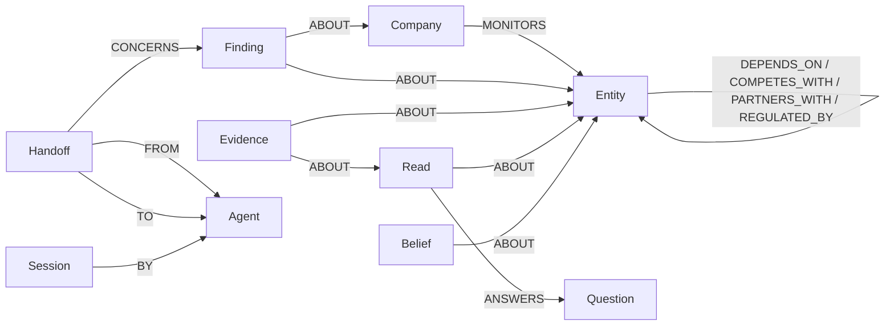

# Bahirjee Intelligence Platform

Autonomous strategic intelligence for founders and strategy leaders, with admin-controlled operations and Supabase-backed persistence.

> **Graph Hacks (FalkorDB) judges:** start at [Graph Hacks submission — Agent Memory & Coordination](#graph-hacks-submission--agent-memory--coordination-falkordb). It covers the track, what was built during the hackathon, the graph model, the Cypher, and a local setup that needs no Supabase.

---

## Documentation Quick Links

| Document | Purpose |
| :--- | :--- |
| [docs/PROJECT_EXECUTION_BRIEF.md](./docs/PROJECT_EXECUTION_BRIEF.md) | **Authoritative architecture, pipeline stages, and provider routing** |
| [docs/DEPLOYMENT.md](./docs/DEPLOYMENT.md) | Production setup for Vercel, Supabase, and Upstash Redis |
| [docs/graph-hacks/](./docs/graph-hacks/) | Graph Hacks: the FalkorDB memory-graph plan and implementation log |

---


## Current Stack

- **Frontend**: React 18, React Router 7, Vite 5, Tailwind CSS
- **Backend / API**: A single Vercel Serverless Function ([api/router.js](./api/router.js)) dispatching to modular handlers in `lib/handlers/*`
- **Database & Auth**: Supabase (PostgreSQL with RLS, triggers, `SECURITY DEFINER` RPCs, and `pgvector`)
- **Search**: Tavily API ([lib/handlers/search.js](./lib/handlers/search.js)) with domain-allowlisted source tiers
- **Scraping**: Parallel AI Extract primary ([lib/handlers/scrape.js](./lib/handlers/scrape.js)), Exa fallback
- **LLM Gateways**:
  - **Gemini Heavy (`gemini-3.8-flash`)**: Extraction, signal analysis, document intel, and Q&A
  - **Gemini Light (`gemini-3.5-flash-lite`)**: Query generation and decision framing
  - **Gemini Reasoning Tier (`gemini-3.1-pro-preview` → `gemini-3.8-flash`)**: Judgment and synthesis (`interpretShifts`, `generateSummary`, `generateDecisionBrief`)
  - **Sarvam**: Cross-provider fallback
  - **Claude / Groq**: Wired but off by default (Claude Haiku active for PDF vision recovery in `lib/_vision.js`)
- **Typed Decisions (Jev)**: TypeSafe Jev (`/api/jev`, server-only) for deterministic scoring and yes/no evaluations across deep reads, evidence triage, page changes, structural findings, news, and advice auditing (shadow by default)
- **Rate Limiting**: Upstash Redis sliding window with in-memory fallback

---

## Execution Model

- **Founder Context Review**: Interactive in the browser so founders can inspect, edit, and confirm inferred context.
- **Server-Owned Execution**: Once confirmed, `POST /api/intelligence` creates a durable `intelligence_jobs` row and triggers the stepped worker (`POST /api/intelligence-worker`).
- **Resilient Pipeline**: Analysis continues uninterrupted even if the user closes the browser tab. UIs poll `GET /api/intelligence?id=...` for live step updates.
- **Run Tiers**: Free runs are `shallow` (8 queries, 3 deep reads, confidence capped); paid runs are `full` (22 queries, 8 deep reads, source watch, structured connectors).

---

## Graph Hacks submission — Agent Memory & Coordination (FalkorDB)

**Track entered: Agent Memory and Coordination.**

Bahirjee's agents (a page *watcher*, a *triage* step, a *pursuer*) and its Ask Bahirjee Q&A used to
forget everything between runs. Every question re-searched the web, and nothing recorded which agent
had handed what to whom. This submission gives them a shared, per-company memory graph in FalkorDB.
They write what they learn and hand off into it, and questions are answered by traversing it:
*what do we already know about X*, *what breaks if X goes down*, *how is X connected to Y*,
*who owns the pending work on X*, *what is load-bearing in our world*.

### What was built during the hackathon

Bahirjee itself (the intelligence pipeline, Supabase schema, React app) existed before 15 Oct
2026, and it is the host this submission plugs into. **Everything graph-related was written
during the hackathon**, on 17–18 Oct 2026, in four commits in the private development repository (squashed into this repo's single commit). The design plan and the implementation log with live-test results are in [docs/graph-hacks/](./docs/graph-hacks/). It comes to about 2,500 lines across these files:

| New | Changed (integration points) |
| :--- | :--- |
| `lib/_graph.js`: connection, per-tenant graph naming, schema, fail-closed reads | `lib/handlers/cron-daily.js`: the daily ladder writes Sessions, Findings, Evidence, Handoffs, Reads |
| `lib/_graphTools.js`: the six fixed tools and their Cypher | `lib/handlers/gemini.js`: `graphAgentStep` (light-tier, schema-constrained tool picker) |
| `lib/_graphWriter.js`: whitelisted MERGE writers | `src/services/promptUtils.js`: the tool-picker prompt |
| `lib/_graphAgent.js`: Reason → Tool → Observe loop, grounding check | `src/components/IntelligenceDashboard.jsx`: Ask Bahirjee asks the graph first |
| `lib/handlers/graph.js`: `/api/graph` (`ask`, `activity`, `record_finding`) | `src/services/intelligenceService.js`: accepted answers are written back |
| `src/services/graphMemory.js`: browser client + provenance line | `api/router.js`: route registration |
| `scripts/graph-seed.mjs`, `scripts/graph-ask.mjs`, `scripts/graph-roundtrip.test.mjs` | `package.json`: `falkordb@6.8.0`, `test:graph` |

### Why the graph is load-bearing, not decoration

Each capability below *is* a graph traversal or graph algorithm. None of them has a non-graph
implementation anywhere in the codebase, so removing FalkorDB removes the capability:

| Capability | How FalkorDB does it | Without FalkorDB |
| :--- | :--- | :--- |
| Memory across sessions: "what did we find about ShipSwift last time?" | `recall`: 1–2 hop traversal over `ABOUT/SUPPORTED_BY/ANSWERS` | Gone: the question is re-researched from scratch |
| Impact: "what breaks if AWS goes down?" | `blast_radius`: variable-length dependency traversal, depth 1–4 | Gone |
| Connection: "how is Acme Freight exposed to State PowerGrid?" | `path_between`: `algo.SPpaths` shortest paths | Gone |
| Structural risk: "what is load-bearing for us?" | `load_bearing`: `algo.pageRank` | Gone |
| Coordination: "who owns the pending work on ShipSwift?" | `next_agent`: pending `Handoff` → `Agent` traversal | Gone: handoffs were never recorded anywhere |
| Change feed | `recent_changes` + `/api/graph activity` | Gone |

`MEMORY_GRAPH_ENABLED=0` is the removal test. Every graph read returns `graph_unavailable`
and every write is skipped. The pre-existing Bahirjee product keeps running, and Ask Bahirjee drops
back to its older context → web ladder with no memory. That fallback is the *old product*, not this
submission: memory, impact, paths, ranking and handoff routing all stop.

**What coordination means today, honestly.** The daily ladder's three rungs write their
handoffs into the graph (`watcher → triage → pursuer`), and the triage → pursuer handoff is marked
done when the pursuit completes. `next_agent` and the activity feed read that shared state. The
rungs still run in sequence inside one cron invocation, so the pursuer does not yet *pick its work*
by querying the graph. That is the next step, not something this submission claims.

### Graph data model

One named graph per tenant: **`bahirjee:{client_id}`**. The name is built only in `lib/_graph.js`,
from a UUID-validated `client_id` that `/api/graph` reads from the authenticated profile. A request
body can never name a graph, so tenant isolation is the graph boundary itself.



| Label | Id format | Key properties |
| :--- | :--- | :--- |
| `Company` | `co:{client_id}` | `name`, `name_key`, `domain` |
| `Entity` | `ent:{tracked_entity id}` | `name`, `name_key` (lowercased; the resolution key), `category` |
| `Agent` | `agt:{name}` | `name` (`watcher` / `triage` / `pursuer`), `role` |
| `Session` | `sess:daily:{client}:{date}` | `kind`, `started_ts` |
| `Finding` | `fnd:{seed}` | `headline`, `ts` |
| `Evidence` | `ev:{…}` | `url`, `ts`, `provenance` (`source_watch` / `read` / `ask_bahirjee`) |
| `Read` | `read:{read id}` | `headline`, `confidence`, `ts` |
| `Question` | `q:{question id}` | `question`, `watch_for`, `status` |
| `Handoff` | `ho:{seed}` | `status` (`pending` / `done`), `reason`, `created_ts`, `completed_ts` |
| `Belief` | `belief:{…}` | `statement`, `confidence` (seeded only; no live writer yet) |

Every node also carries `tenant` and a unique `id`. `ensureSchema()` creates a unique
constraint on `id` and an index per label.

### The Cypher the product depends on

The LLM never writes Cypher. It picks one of six tools and fills typed arguments, and these
human-reviewed, parameterised queries run (full source in [lib/_graphTools.js](./lib/_graphTools.js)).
The one interpolated value is `depth`, which is integer-validated against `MAX_DEPTH = 4` first,
because Cypher cannot parameterise variable-length bounds. Relationship lists are constants.

**Entity gate.** Runs before every tool. A miss returns `unknown_entity` and *no other query runs*:
```cypher
MATCH (e) WHERE (e:Entity OR e:Company) AND e.name_key = $key RETURN e LIMIT 2
```

**`recall(entity)`:** prior findings, reads, evidence, questions:
```cypher
MATCH (e {id: $id})
MATCH p = (x)-[:ABOUT|SUPPORTED_BY|CONTRADICTED_BY|TESTS|ANSWERS*1..2]-(e)
WHERE x:Finding OR x:Read OR x:Belief OR x:Evidence OR x:Question
RETURN x, p LIMIT $limit
```

**`blast_radius(entity, depth)`:** complete dependency paths, depth 1–4:
```cypher
MATCH (e {id: $id})
MATCH p = (e)-[:DEPENDS_ON|PARTNERS_WITH|COMPETES_WITH|MONITORS|REGULATED_BY*1..{depth}]-(x)
RETURN p LIMIT $limit
```

**`path_between(a, b)`:** FalkorDB's shortest-paths algorithm:
```cypher
MATCH (s {id: $a}), (t {id: $b})
CALL algo.SPpaths({sourceNode: s, targetNode: t,
                   relTypes: ['DEPENDS_ON','PARTNERS_WITH','COMPETES_WITH','MONITORS','REGULATED_BY'],
                   undirected: true, pathCount: 3, maxLen: 6})
YIELD path RETURN path LIMIT $limit
```

**`load_bearing(limit)`:** PageRank over the tenant graph:
```cypher
CALL algo.pageRank(NULL, NULL) YIELD node, score
WITH node, score WHERE node:Entity
RETURN node, score ORDER BY score DESC LIMIT $limit
```

**`next_agent(entity)`:** coordination state:
```cypher
MATCH (e {id: $id})<-[:ABOUT]-(work)<-[:CONCERNS]-(h:Handoff {status: 'pending'})
MATCH (h)-[:FROM]->(fromAgt:Agent), (h)-[:TO]->(toAgt:Agent)
RETURN h, work, fromAgt, toAgt LIMIT 3
```

**`recent_changes(entity, since)`:**
```cypher
MATCH (e {id: $id})<-[:ABOUT]-(n)
WHERE (n:Finding OR n:Evidence OR n:Read)
  AND coalesce(n.ts, n.observed_at, n.created_ts, 0) >= $since
RETURN n LIMIT $limit
```

**Writes** ([lib/_graphWriter.js](./lib/_graphWriter.js)) are idempotent MERGEs. `label` and `rel`
come from fixed whitelists, never from input:
```cypher
MERGE (n:{Label} {id: $id}) SET n += $props
MATCH (a {id: $a}), (b {id: $b}) MERGE (a)-[r:{REL}]->(b) SET r += $props
MATCH (h:Handoff {id: $id}) SET h.status = 'done', h.completed_ts = $ts
```

**Activity feed** (`POST /api/graph` with `action: 'activity'`, in
[lib/handlers/graph.js](./lib/handlers/graph.js)): the latest work the agents wrote, newest first:
```cypher
MATCH (n)
WHERE n:Handoff OR n:Finding OR n:Read OR n:Session
RETURN n ORDER BY coalesce(n.ts, n.created_ts, n.started_ts, n.observed_at, 0) DESC
LIMIT $limit
```

**Schema bootstrap** (`ensureSchema()` in [lib/_graph.js](./lib/_graph.js)), run once per tenant
graph. A unique `id` constraint is created for each of the ten labels through the client's
`constraintCreate('UNIQUE', 'NODE', label, 'id')`. That is a FalkorDB module command
(`GRAPH.CONSTRAINT CREATE`), not Cypher. The indexes are Cypher:
```cypher
CREATE INDEX FOR (n:{Label}) ON (n.id)          -- for each of the ten labels
CREATE INDEX FOR (e:Entity) ON (e.name_key)     -- backs the entity gate
```
An index or constraint that already exists counts as success, so bootstrap is safe to repeat.

**Try every query yourself:** [docs/graph-hacks/queries.cypher](./docs/graph-hacks/queries.cypher)
has all of the queries above with their parameters filled in from the seed tenant. After
`scripts/graph-seed.mjs`, paste them one at a time into FalkorDB Browser on graph
`bahirjee:00000000-0000-4000-8000-00000000000d`.

### The agent loop

[lib/_graphAgent.js](./lib/_graphAgent.js): Reason → Tool → Observe, hard-capped at
`MEMORY_GRAPH_MAX_STEPS` (4). Each step is one schema-constrained Gemini light-tier call that
returns `{done, tool, args, answer}`.
- Questions about prior work ("last time", "earlier") are **forced to `recall` first**.
- Tool names are matched against the fixed catalogue. Entity arguments are re-checked against
  entities probed from the question, so a model-invented argument is replaced, never trusted.
- The **outcome is derived from what the tools returned**, never from the model's say-so:
  `answered_with_path`, `answered_from_memory`, `unknown_entity` (no query ran), `not_in_graph`
  (known but disconnected: a coverage fact, not a claim of absence), or `graph_unavailable`.
- A final answer naming an entity no tool returned is **rejected**. A description of the real top
  path replaces it.
- In the app every graph answer ends with a provenance line: tool, path, and when it was remembered.

### Data used

The demo tenant ("Acme Freight", `scripts/graph-seed.mjs`) is **entirely synthetic**: 24 nodes and
33 edges, including a 4-deep `DEPENDS_ON` chain (Acme → Kubernetes → AWS → Equinix → State PowerGrid),
a competitor that shares the AWS dependency, and a deliberately disconnected Zendesk. In normal use
the graph holds only public web pages Bahirjee watched and answers the user accepted. No
login-protected or personal data is loaded into it.

### Run it locally (graph only, no Supabase needed)

Requirements: Node 20+, Docker (or a FalkorDB Cloud instance), a Gemini API key.

```bash
git clone https://github.com/saurabhjambure-pixel/bahirjee-graph-memory.git
cd bahirjee-graph-memory
npm install

# 1. FalkorDB: local Docker (or FalkorDB Cloud; free tier has no TLS, so use falkor://, not falkors://)
docker run -d -p 6379:6379 -p 3000:3000 falkordb/falkordb

# 2. Minimal .env for the graph layer
cat > .env <<'EOF'
FALKORDB_URL=falkor://localhost:6379
# FALKORDB_USERNAME=…   FALKORDB_PASSWORD=…   (Cloud only)
MEMORY_GRAPH_ENABLED=1
MEMORY_GRAPH_MAX_STEPS=4
GEMINI_API_KEY=your-gemini-key
INTERNAL_API_KEY=any-long-random-string
EOF

# 3. Seed the synthetic tenant, run the offline test matrix
node --env-file=.env scripts/graph-seed.mjs
npm run test:graph                      # 15 checks, fake FalkorDB client, no network

# 4. Ask the graph (the same loop /api/graph runs)
node --env-file=.env scripts/graph-ask.mjs "What breaks if AWS goes down?"
node --env-file=.env scripts/graph-ask.mjs "How is Acme Freight connected to State PowerGrid?"
node --env-file=.env scripts/graph-ask.mjs "What is load-bearing for us?"
node --env-file=.env scripts/graph-ask.mjs "Who picks up the ShipSwift work next?"
node --env-file=.env scripts/graph-ask.mjs "What did we find about ShipSwift last time?"
node --env-file=.env scripts/graph-ask.mjs "What do we know about Zorblax?"   # unknown_entity, no query runs

# 5. Removal test: the graph capabilities disappear and say so
MEMORY_GRAPH_ENABLED=0 node --env-file=.env scripts/graph-ask.mjs "What breaks if AWS goes down?"
```

Open the FalkorDB Browser at http://localhost:3000 and select graph
`bahirjee:00000000-0000-4000-8000-00000000000d` to see what the tools traverse. Then run the
queries in [docs/graph-hacks/queries.cypher](./docs/graph-hacks/queries.cypher) one at a time.

**Full app** (Ask Bahirjee in the browser, the daily ladder): this also needs a Supabase project
(`schema.sql` + `scripts/migrations/`) and the variables in `.env.example`. See
[docs/DEPLOYMENT.md](./docs/DEPLOYMENT.md). Locally, `DEV_AUTH_BYPASS=true`,
`VITE_DEV_AUTH_BYPASS=true` and `DEV_BYPASS_CLIENT_ID=00000000-0000-4000-8000-00000000000d` point the
app at the seeded tenant without a login.

### AI-assistance disclosure

AI coding agents were used, as the rules allow:
- The graph layer (all files listed above) was written with **Devin**, an AI coding agent. The team
  designed the approach and the graph model, directed it, reviewed the Cypher, and tested it
  end-to-end against live FalkorDB Cloud and Gemini. The bugs that testing found are in the commit
  history (company-id split, name clobbering, entity probing, and the model's sloppy tool output).
- This README section and `scripts/graph-ask.mjs` were prepared with a second AI coding assistant, then reviewed by the team.

---

## Development & Test Commands

```bash
# Run local dev server (frontend + API proxy)
npm run dev

# Run Vercel emulation locally
npm run dev:vercel

# Build production bundle to dist/
npm run build

# Preview production build
npm run preview
```

### Test Suites (Plain Node)

```bash
npm run test:graph         # memory-graph outcome matrix (fake FalkorDB, no network)
npm run test:router        # api/router.js dispatch, including the /api/graph route
npm run test:cron-daily    # the daily ladder that writes Sessions, Findings and Handoffs
npm run test:ask           # Ask Bahirjee, which asks the graph first
```

---

## Key Files

- [api/router.js](./api/router.js) — The single Vercel function (do not add more files to `api/`)
- [lib/handlers/intelligence.js](./lib/handlers/intelligence.js) — Job creation, status, and polling
- [lib/handlers/intelligence-worker.js](./lib/handlers/intelligence-worker.js) — Worker endpoint
- [lib/_intelligenceWorker.js](./lib/_intelligenceWorker.js) — Stepped pipeline driver
- [src/services/intelligenceService.js](./src/services/intelligenceService.js) — 11-step pipeline orchestrator
- [src/components/IntelligenceDashboard.jsx](./src/components/IntelligenceDashboard.jsx) — Main founder UI state machine
- [src/pages/admin/ClientDetail.jsx](./src/pages/admin/ClientDetail.jsx) — Admin client management & intelligence runner
- [schema.sql](./schema.sql) — System of record database schema
- [lib/_graph.js](./lib/_graph.js) — FalkorDB connection, per-tenant graph naming, disabled path
- [lib/handlers/graph.js](./lib/handlers/graph.js) — `/api/graph`: `ask`, `activity`, `record_finding`
