# Bahirjee Intelligence Platform — Complete Database Schema & Data Dictionary

> **Generated Date:** 2026-09-24  
> **Database Engine:** PostgreSQL 15+ (Supabase)  
> **Extensions:** `uuid-ossp`, `pgcrypto`, `vector` (`pgvector`)  
> **Security Model:** Strict Row-Level Security (RLS) with Tenant Isolation and `SECURITY DEFINER` RPCs

---

## 1. Architectural Domain Overview

The Bahirjee Intelligence platform database consists of **35 tables** partitioned across **8 primary architectural domains**:

- **Identity, Access & Multi-Tenancy** (4 tables): `clients, profiles, email_allowlist, waitlist`
- **Intelligence Job Orchestration** (1 tables): `intelligence_jobs`
- **Reports, Strategic Decisions & Brief Access** (6 tables): `reports, decision_briefs, interactions, report_access_log, report_access_blocks, report_access_requests`
- **Context, Memory & Knowledge Store** (6 tables): `startup_contexts, company_contexts, company_memory_state, brief_cards, brief_card_evidence, document_chunks`
- **Entity Watch & Surveillance** (3 tables): `tracked_entities, entity_sources, entity_source_snapshots`
- **Signal Engine & Synthesis** (8 tables): `observations, structured_signals, news_items, patterns, shifts, blind_spots, opportunities, impact_events`
- **Strategic Agenda & Continuous Surveillance** (3 tables): `open_questions, reads, daily_checks`
- **Autonomous Agent Runtime** (4 tables): `agent_runs, agent_artifacts, agent_handoffs, agent_evaluations`

---

## 2. Entity-Relationship (ER) Diagram

The diagram below illustrates the structural relationships, foreign key dependencies, and cardinalities between core platform domains:

```mermaid
erDiagram
    CLIENTS ||--o{ PROFILES : "has"
    CLIENTS ||--o{ EMAIL_ALLOWLIST : "authorizes"
    CLIENTS ||--o{ INTELLIGENCE_JOBS : "executes"
    CLIENTS ||--o{ REPORTS : "owns"
    CLIENTS ||--o{ DECISION_BRIEFS : "frames"
    CLIENTS ||--o{ STARTUP_CONTEXTS : "versions"
    CLIENTS ||--o{ COMPANY_CONTEXTS : "configures"
    CLIENTS ||--|| COMPANY_MEMORY_STATE : "maintains"
    CLIENTS ||--o{ BRIEF_CARDS : "tracks"
    CLIENTS ||--o{ TRACKED_ENTITIES : "monitors"
    CLIENTS ||--o{ OBSERVATIONS : "gathers"
    CLIENTS ||--o{ STRUCTURED_SIGNALS : "extracts"
    CLIENTS ||--o{ NEWS_ITEMS : "curates"
    CLIENTS ||--o{ PATTERNS : "clusters"
    CLIENTS ||--o{ SHIFTS : "detects"
    CLIENTS ||--o{ BLIND_SPOTS : "reveals"
    CLIENTS ||--o{ OPPORTUNITIES : "surfaces"
    CLIENTS ||--o{ OPEN_QUESTIONS : "maintains"
    CLIENTS ||--o{ READS : "publishes"
    CLIENTS ||--o{ DAILY_CHECKS : "logs"
    REPORTS ||--o{ INTERACTIONS : "contains"
    REPORTS ||--o{ REPORT_ACCESS_LOG : "logs_access"
    REPORTS ||--o{ REPORT_ACCESS_REQUESTS : "requests"
    REPORTS ||--o{ BRIEF_CARD_EVIDENCE : "evidences"
    REPORTS |o--o| REPORTS : "supersedes"
    REPORTS |o--o| DECISION_BRIEFS : "links_decision"
    INTELLIGENCE_JOBS ||--o{ AGENT_RUNS : "dispatches"
    INTELLIGENCE_JOBS ||--o{ AGENT_ARTIFACTS : "produces"
    INTELLIGENCE_JOBS ||--o{ AGENT_HANDOFFS : "coordinates"
    INTELLIGENCE_JOBS ||--o{ AGENT_EVALUATIONS : "evaluates"
    AGENT_RUNS ||--o{ AGENT_ARTIFACTS : "generates"
    AGENT_RUNS ||--o{ AGENT_EVALUATIONS : "scored_by"
    TRACKED_ENTITIES ||--o{ ENTITY_SOURCES : "watches"
    ENTITY_SOURCES ||--o{ ENTITY_SOURCE_SNAPSHOTS : "snapshots"
    TRACKED_ENTITIES ||--o{ STRUCTURED_SIGNALS : "emits"
    OBSERVATIONS ||--o{ STRUCTURED_SIGNALS : "grounds"
    STRUCTURED_SIGNALS ||--o{ NEWS_ITEMS : "informs"
    PATTERNS ||--o{ SHIFTS : "triggers"
    BRIEF_CARDS ||--o{ BRIEF_CARD_EVIDENCE : "supported_by"
    OPEN_QUESTIONS ||--o{ READS : "answers"
    READS |o--o| DAILY_CHECKS : "produced_by"
```

---

## 3. Data Dictionary: Tables & Column Specifications

### Identity, Access & Multi-Tenancy

#### Table: `clients`

*Organizations / workspaces representing companies or client accounts. Supports self-serve or admin-provisioned tenants.*

| Column Name | Data Type | Constraints & Defaults | Foreign Key / Reference | Description |
| :--- | :--- | :--- | :--- | :--- |
| `id` **`PK`** | `uuid` | PRIMARY KEY DEFAULT gen_random_uuid() | - | Unique identifier for the client workspace |
| `name` | `text` | NOT NULL | - | Client / Organization name |
| `domain` | `text` | UNIQUE | - | Primary domain for automatic user matching and tenant association |
| `status` | `text` | DEFAULT 'active' CHECK (status IN ('active', 'inactive')) | - | Tenant status: active or inactive |
| `exempt_from_freemium` | `boolean` | DEFAULT false | - | Bypasses all freemium limits when true |
| `self_serve` | `boolean` | DEFAULT false | - | Distinguishes self-serve signups from admin-provisioned tenants |
| `seed_email` | `text` | NULL | - | Initial email address used to seed/create the workspace |
| `member_cap` | `integer` | DEFAULT 25 | - | Maximum member capacity for self-serve workspace |
| `auto_run_cadence` | `text` | NULL | - | Cadence for scheduled intelligence runs (e.g. weekly, monthly) |
| `auto_run_last_queued_at` | `timestamptz` | NULL | - | Timestamp of the last scheduled run queued for this client |
| `created_at` | `timestamptz` | NOT NULL DEFAULT timezone('utc'::text, now()) | - | Workspace creation timestamp |

#### Table: `profiles`

*User accounts linked to Supabase Auth (`auth.users`), storing roles, permissions, and workspace memberships.*

| Column Name | Data Type | Constraints & Defaults | Foreign Key / Reference | Description |
| :--- | :--- | :--- | :--- | :--- |
| `id` **`PK`** | `uuid` | PRIMARY KEY REFERENCES auth.users(id) ON DELETE CASCADE | `auth.users.id` | User ID mirroring auth.users |
| `full_name` | `text` | NULL | - | User's full name |
| `role` | `text` | DEFAULT 'client_user' CHECK (role IN ('admin', 'client_user', 'brief_viewer')) | - | User access role |
| `client_id` | `uuid` | REFERENCES public.clients(id) ON DELETE SET NULL | `clients.id` | Foreign key to clients workspace |
| `is_active` | `boolean` | DEFAULT true | - | Account activation flag |
| `is_premium` | `boolean` | DEFAULT false | - | Premium tier subscription flag bypassing report limits |
| `run_count` | `integer` | NOT NULL DEFAULT 0 | - | Number of intelligence runs executed by the user |
| `letter_opt_out` | `boolean` | NOT NULL DEFAULT false | - | Opt-out preference for the weekly intelligence letter |
| `created_at` | `timestamptz` | NOT NULL DEFAULT timezone('utc'::text, now()) | - | Profile creation timestamp |
| `updated_at` | `timestamptz` | NOT NULL DEFAULT timezone('utc'::text, now()) | - | Profile last updated timestamp |

#### Table: `email_allowlist`

*Pre-provisioned email access list for explicit user invitations and role grants.*

| Column Name | Data Type | Constraints & Defaults | Foreign Key / Reference | Description |
| :--- | :--- | :--- | :--- | :--- |
| `email` **`PK`** | `text` | PRIMARY KEY | - | Authorized email address |
| `client_id` | `uuid` | REFERENCES public.clients(id) ON DELETE CASCADE | `clients.id` | Associated client organization |
| `role` | `text` | DEFAULT 'client_user' CHECK (role IN ('admin', 'client_user', 'brief_viewer')) | - | Assigned role upon signup |
| `is_active` | `boolean` | DEFAULT true | - | Whether this allowlist entry is active |
| `created_at` | `timestamptz` | NOT NULL DEFAULT timezone('utc'::text, now()) | - | Creation timestamp |

#### Table: `waitlist`

*Public landing page waitlist entries for prospective users.*

| Column Name | Data Type | Constraints & Defaults | Foreign Key / Reference | Description |
| :--- | :--- | :--- | :--- | :--- |
| `id` **`PK`** | `bigint` | GENERATED BY DEFAULT AS IDENTITY PRIMARY KEY | - | Unique waitlist ID |
| `name` | `text` | NULL | - | Prospect name |
| `email` | `text` | NULL | - | Prospect email |
| `startup_url` | `text` | NULL | - | Startup or company website URL |
| `country` | `text` | NULL | - | Prospect country/location |
| `created_at` | `timestamptz` | NOT NULL DEFAULT timezone('utc'::text, now()) | - | Submission timestamp |

### Intelligence Job Orchestration

#### Table: `intelligence_jobs`

*Asynchronous job records orchestrating multi-step intelligence pipeline runs with checkpoints and status polling.*

| Column Name | Data Type | Constraints & Defaults | Foreign Key / Reference | Description |
| :--- | :--- | :--- | :--- | :--- |
| `id` **`PK`** | `uuid` | PRIMARY KEY DEFAULT gen_random_uuid() | - | Unique job identifier |
| `client_id` | `uuid` | NOT NULL REFERENCES public.clients(id) ON DELETE CASCADE | `clients.id` | Owning client organization |
| `created_by` | `uuid` | NOT NULL REFERENCES auth.users(id) ON DELETE SET NULL | `auth.users.id` | User who requested the job |
| `website_url` | `text` | NOT NULL | - | Target company website analyzed |
| `linkedin_url` | `text` | NULL | - | Optional company LinkedIn URL |
| `job_origin` | `text` | DEFAULT 'founder' CHECK (job_origin IN ('founder', 'admin', 'scheduled')) | - | Origin trigger of the run |
| `requested_by_role` | `text` | DEFAULT 'client_user' CHECK (requested_by_role IN ('admin', 'client_user')) | - | Role of the requesting user |
| `status` | `text` | DEFAULT 'pending' CHECK (status IN ('pending', 'processing', 'awaiting_context_review', 'completed', 'failed')) | - | Current job status |
| `current_step` | `text` | NULL | - | Current step in the intelligence worker pipeline |
| `progress_log` | `jsonb` | DEFAULT '[]'::jsonb | - | Ordered log of progress messages and step transitions |
| `step_outputs` | `jsonb` | NOT NULL DEFAULT '{}'::jsonb | - | Durable checkpoint payload holding intermediate step artifacts |
| `context_payload` | `jsonb` | NULL | - | Context override payload from user onboarding or context review |
| `uploaded_doc_text` | `text` | NULL | - | Parsed text from uploaded pitch decks or documents |
| `build_context_on_server` | `boolean` | DEFAULT false | - | Flag indicating whether context building executes entirely on worker |
| `reserved_run` | `boolean` | DEFAULT false | - | Flag indicating atomic quota reservation was secured |
| `analysis_mode` | `text` | DEFAULT 'company' CHECK (analysis_mode IN ('company', 'decision')) | - | Mode of analysis |
| `run_tier` | `text` | DEFAULT 'full' CHECK (run_tier IN ('shallow', 'full')) | - | Execution depth allowance (shallow vs full) |
| `decision_id` | `uuid` | REFERENCES public.decision_briefs(id) ON DELETE SET NULL | `decision_briefs.id` | Associated decision brief if in decision mode |
| `decision_context` | `jsonb` | DEFAULT '{}'::jsonb | - | Context parameters specific to a decision brief |
| `report_id` | `uuid` | REFERENCES public.reports(id) ON DELETE SET NULL | `reports.id` | Link to final generated report |
| `error_message` | `text` | NULL | - | Error details if status is failed |
| `attempt_count` | `integer` | NOT NULL DEFAULT 0 | - | Number of execution attempts |
| `started_at` | `timestamptz` | NULL | - | Job execution start timestamp |
| `completed_at` | `timestamptz` | NULL | - | Job execution completion timestamp |
| `last_heartbeat_at` | `timestamptz` | NULL | - | Worker liveness heartbeat timestamp |
| `lock_expires_at` | `timestamptz` | NULL | - | Lease expiration timestamp preventing concurrent processing |
| `created_at` | `timestamptz` | NOT NULL DEFAULT timezone('utc'::text, now()) | - | Job creation timestamp |
| `updated_at` | `timestamptz` | NOT NULL DEFAULT timezone('utc'::text, now()) | - | Job update timestamp |

### Reports, Strategic Decisions & Brief Access

#### Table: `reports`

*Published strategic intelligence reports and briefs synthesised from observations, patterns, and signals.*

| Column Name | Data Type | Constraints & Defaults | Foreign Key / Reference | Description |
| :--- | :--- | :--- | :--- | :--- |
| `id` **`PK`** | `uuid` | PRIMARY KEY DEFAULT gen_random_uuid() | - | Unique report identifier |
| `client_id` | `uuid` | NOT NULL REFERENCES public.clients(id) ON DELETE CASCADE | `clients.id` | Owning client organization |
| `created_by` | `uuid` | REFERENCES auth.users(id) ON DELETE SET NULL | `auth.users.id` | User who initiated the report |
| `website_url` | `text` | NOT NULL | - | Target website investigated |
| `target_domain` | `text` | NULL | - | Canonical domain extracted for indexing and multi-report lineage |
| `context` | `jsonb` | NULL | - | Snapshot of company profile, assumptions, and exposure weights |
| `signals` | `jsonb` | NULL | - | Grounding signals verified and cited in this report |
| `brief` | `jsonb` | NULL | - | Structured synthesis brief (executive summary, strategic shifts, blind spots, news) |
| `memory_state` | `jsonb` | DEFAULT '{}'::jsonb | - | Cumulative delta memory state snapshot |
| `card_summary` | `jsonb` | DEFAULT '[]'::jsonb | - | Active brief cards materialized for UI rendering |
| `based_on_report_id` | `uuid` | REFERENCES public.reports(id) ON DELETE SET NULL | `reports.id` | Prior report this run builds upon |
| `run_fingerprint` | `text` | NULL | - | Hash of search and input parameters to avoid redundant runs |
| `effective_at` | `timestamptz` | NOT NULL DEFAULT timezone('utc'::text, now()) | - | Effective date for temporal intelligence ordering |
| `is_current_snapshot` | `boolean` | DEFAULT true | - | Whether this is the latest active report for the target domain |
| `superseded_by_report_id` | `uuid` | REFERENCES public.reports(id) ON DELETE SET NULL | `reports.id` | Report that replaces this snapshot |
| `share_token` | `uuid` | UNIQUE DEFAULT gen_random_uuid() | - | Public/domain token for shared view access |
| `degradations` | `jsonb` | DEFAULT '[]'::jsonb | - | Ledger of pipeline degradations or ungrounded dropped items |
| `report_kind` | `text` | DEFAULT 'company' CHECK (report_kind IN ('company', 'decision')) | - | Type of brief: company landscape or strategic decision |
| `decision_id` | `uuid` | REFERENCES public.decision_briefs(id) ON DELETE SET NULL | `decision_briefs.id` | Linked decision brief when report_kind='decision' |
| `decision_context` | `jsonb` | DEFAULT '{}'::jsonb | - | Snapshot of decision options and framework inputs |
| `decision_brief` | `jsonb` | DEFAULT '{}'::jsonb | - | Evaluation matrix and recommendation payload |
| `run_tier` | `text` | DEFAULT 'full' CHECK (run_tier IN ('shallow', 'full')) | - | Execution tier recorded for traceability |
| `verification` | `jsonb` | NULL | - | Validation metadata and grounding audit report |
| `run_id` | `uuid` | NULL | - | Deduplication and idempotency key mapping to agent/job run |
| `created_at` | `timestamptz` | NOT NULL DEFAULT timezone('utc'::text, now()) | - | Creation timestamp |

#### Table: `decision_briefs`

*Durable strategic decision identities that founders can frame, evaluate, revisit, and track over time.*

| Column Name | Data Type | Constraints & Defaults | Foreign Key / Reference | Description |
| :--- | :--- | :--- | :--- | :--- |
| `id` **`PK`** | `uuid` | PRIMARY KEY DEFAULT gen_random_uuid() | - | Unique decision identifier |
| `client_id` | `uuid` | NOT NULL REFERENCES public.clients(id) ON DELETE CASCADE | `clients.id` | Owning client organization |
| `created_by` | `uuid` | NOT NULL REFERENCES auth.users(id) ON DELETE SET NULL | `auth.users.id` | User who framed the decision |
| `raw_input` | `text` | NOT NULL | - | Founder's initial natural language framing of the decision |
| `decision_frame` | `jsonb` | NOT NULL DEFAULT '{}'::jsonb | - | Structured decision options, trade-offs, and constraints |
| `latest_report_id` | `uuid` | REFERENCES public.reports(id) ON DELETE SET NULL | `reports.id` | Most recent intelligence report generated for this decision |
| `answers` | `jsonb` | NOT NULL DEFAULT '{}'::jsonb | - | Founder's answers on reversibility, worst case, delay cost, and exclusivity |
| `framework` | `text` | CHECK (framework IS NULL OR framework IN ('mcda', 'wrap', 'regret', 'eisenhower', 'satisficing')) | - | Decision framework selected |
| `judgment` | `jsonb` | NOT NULL DEFAULT '{}'::jsonb | - | Evaluated decision brief with scores, sensitivities, and recommendations |
| `chosen_option_id` | `text` | NULL | - | Option ID actually chosen by the founder |
| `decided_at` | `timestamptz` | NULL | - | Timestamp when the decision was finalized |
| `target_domain` | `text` | NULL | - | Domain of the company under consideration |
| `created_at` | `timestamptz` | NOT NULL DEFAULT timezone('utc'::text, now()) | - | Creation timestamp |
| `updated_at` | `timestamptz` | NOT NULL DEFAULT timezone('utc'::text, now()) | - | Last updated timestamp |

#### Table: `interactions`

*Q&A interactions ('Ask Bahirjee') and user notes attached to reports, with freemium rate limiting.*

| Column Name | Data Type | Constraints & Defaults | Foreign Key / Reference | Description |
| :--- | :--- | :--- | :--- | :--- |
| `id` **`PK`** | `uuid` | PRIMARY KEY DEFAULT gen_random_uuid() | - | Unique interaction ID |
| `report_id` | `uuid` | NOT NULL REFERENCES public.reports(id) ON DELETE CASCADE | `reports.id` | Referenced report |
| `user_id` | `uuid` | NOT NULL REFERENCES auth.users(id) ON DELETE CASCADE | `auth.users.id` | User who asked or took note |
| `interaction_type` | `text` | NOT NULL CHECK (interaction_type IN ('question', 'note', 'conversion_click')) | - | Interaction category |
| `content` | `text` | NULL | - | Question text or note content |
| `answer` | `text` | NULL | - | AI-generated response for questions |
| `created_at` | `timestamptz` | NOT NULL DEFAULT timezone('utc'::text, now()) | - | Interaction creation timestamp |

#### Table: `report_access_log`

*Audit log of external or internal access events to shared intelligence reports.*

| Column Name | Data Type | Constraints & Defaults | Foreign Key / Reference | Description |
| :--- | :--- | :--- | :--- | :--- |
| `id` **`PK`** | `uuid` | PRIMARY KEY DEFAULT gen_random_uuid() | - | Unique log entry ID |
| `report_id` | `uuid` | NOT NULL REFERENCES public.reports(id) ON DELETE CASCADE | `reports.id` | Viewed report |
| `client_id` | `uuid` | REFERENCES public.clients(id) ON DELETE CASCADE | `clients.id` | Owning client organization |
| `user_id` | `uuid` | REFERENCES auth.users(id) ON DELETE SET NULL | `auth.users.id` | Authenticated user ID if logged in |
| `email` | `text` | NOT NULL | - | Email address of the viewer |
| `accessed_via` | `text` | DEFAULT 'share_token' CHECK (accessed_via IN ('share_token', 'company_slug')) | - | Access route |
| `created_at` | `timestamptz` | NOT NULL DEFAULT timezone('utc'::text, now()) | - | Access timestamp |

#### Table: `report_access_blocks`

*Explicit email blocks that deny access to shared reports for a client workspace.*

| Column Name | Data Type | Constraints & Defaults | Foreign Key / Reference | Description |
| :--- | :--- | :--- | :--- | :--- |
| `client_id` **`PK`** | `uuid` | NOT NULL REFERENCES public.clients(id) ON DELETE CASCADE | `clients.id` | Client workspace |
| `email` **`PK`** | `text` | NOT NULL | - | Blocked email address |
| `reason` | `text` | NULL | - | Reason for the access block |
| `created_by` | `uuid` | REFERENCES auth.users(id) ON DELETE SET NULL | `auth.users.id` | Admin who issued the block |
| `created_at` | `timestamptz` | NOT NULL DEFAULT timezone('utc'::text, now()) | - | Block creation timestamp |

#### Table: `report_access_requests`

*Pending or resolved access requests from outside domain users attempting to view a report.*

| Column Name | Data Type | Constraints & Defaults | Foreign Key / Reference | Description |
| :--- | :--- | :--- | :--- | :--- |
| `id` **`PK`** | `uuid` | PRIMARY KEY DEFAULT gen_random_uuid() | - | Unique request ID |
| `report_id` | `uuid` | NOT NULL REFERENCES public.reports(id) ON DELETE CASCADE | `reports.id` | Requested report |
| `client_id` | `uuid` | REFERENCES public.clients(id) ON DELETE CASCADE | `clients.id` | Owning client workspace |
| `email` | `text` | NOT NULL | - | Requesting email address |
| `user_id` | `uuid` | REFERENCES auth.users(id) ON DELETE SET NULL | `auth.users.id` | User ID if registered |
| `status` | `text` | DEFAULT 'pending' CHECK (status IN ('pending', 'approved', 'denied')) | - | Request status |
| `created_at` | `timestamptz` | NOT NULL DEFAULT timezone('utc'::text, now()) | - | Request timestamp |
| `resolved_at` | `timestamptz` | NULL | - | Resolution timestamp |
| `resolved_by` | `uuid` | REFERENCES auth.users(id) ON DELETE SET NULL | `auth.users.id` | Admin who approved/denied the request |

### Context, Memory & Knowledge Store

#### Table: `startup_contexts`

*Versioned company profiles capturing revenue models, competitive maps, dependencies, and assumptions.*

| Column Name | Data Type | Constraints & Defaults | Foreign Key / Reference | Description |
| :--- | :--- | :--- | :--- | :--- |
| `id` **`PK`** | `uuid` | PRIMARY KEY DEFAULT gen_random_uuid() | - | Unique context version ID |
| `company_id` | `uuid` | NOT NULL REFERENCES public.clients(id) ON DELETE CASCADE | `clients.id` | Client workspace |
| `version_id` | `text` | NULL | - | Unique version string tag |
| `revenue_profile` | `jsonb` | DEFAULT '{}'::jsonb | - | Model, customer types, sales motion, funding stage |
| `market_profile` | `jsonb` | DEFAULT '{}'::jsonb | - | Industry, category, vertical, target persona |
| `dependency_map` | `jsonb` | DEFAULT '{}'::jsonb | - | Infra, platform, integration, and regulatory dependencies |
| `competitive_map` | `jsonb` | DEFAULT '{}'::jsonb | - | Named competitors, category peers, adjacent solutions |
| `strategic_assumptions` | `jsonb` | DEFAULT '[]'::jsonb | - | Founder assumptions with domain and sensitivity ratings |
| `exposure_weights` | `jsonb` | DEFAULT '{}'::jsonb | - | Normalized exposure weights (capital, demand, cost, etc.) |
| `sensitivity_snapshot` | `jsonb` | DEFAULT '{}'::jsonb | - | Infra cost, revenue slowdown, hiring sensitivities |
| `onboarding_inputs` | `jsonb` | DEFAULT '{}'::jsonb | - | Raw onboarding form data |
| `auto_inferred` | `jsonb` | DEFAULT '{}'::jsonb | - | Raw Gemini inferences for audit trail |
| `created_at` | `timestamptz` | NOT NULL DEFAULT timezone('utc'::text, now()) | - | Context snapshot creation timestamp |

#### Table: `company_contexts`

*Domain-keyed canonical repository of company context, shared across runs for the same target domain.*

| Column Name | Data Type | Constraints & Defaults | Foreign Key / Reference | Description |
| :--- | :--- | :--- | :--- | :--- |
| `id` **`PK`** | `uuid` | PRIMARY KEY DEFAULT gen_random_uuid() | - | Context record ID |
| `client_id` | `uuid` | NOT NULL REFERENCES public.clients(id) ON DELETE CASCADE | `clients.id` | Owning client workspace |
| `target_domain` | `text` | NOT NULL | - | Normalized target domain (e.g. acme.com) |
| `source` | `text` | NOT NULL DEFAULT 'onboarding' CHECK (source IN ('onboarding', 'uploaded_deck', 'scraped_site', 'inferred', 'manual_edit')) | - | Provenance source of context |
| `context` | `jsonb` | NOT NULL DEFAULT '{}'::jsonb | - | Canonical context payload (positioning, ICP, ICP assumptions, competitors) |
| `version` | `integer` | NOT NULL DEFAULT 1 | - | Sequential revision counter |
| `created_by` | `uuid` | REFERENCES auth.users(id) ON DELETE SET NULL | `auth.users.id` | User who modified context |
| `created_at` | `timestamptz` | NOT NULL DEFAULT timezone('utc'::text, now()) | - | Creation timestamp |
| `updated_at` | `timestamptz` | NOT NULL DEFAULT timezone('utc'::text, now()) | - | Last updated timestamp |

#### Table: `company_memory_state`

*Longitudinal intelligence memory per company tracking active signals, trend evolution, and brief cards.*

| Column Name | Data Type | Constraints & Defaults | Foreign Key / Reference | Description |
| :--- | :--- | :--- | :--- | :--- |
| `company_id` **`PK`** | `uuid` | PRIMARY KEY REFERENCES public.clients(id) ON DELETE CASCADE | `clients.id` | Client workspace ID |
| `latest_report_id` | `uuid` | REFERENCES public.reports(id) ON DELETE SET NULL | `reports.id` | Most recent report applied to memory |
| `latest_context_version_id` | `text` | NULL | - | Context version tag used in latest run |
| `memory_state` | `jsonb` | DEFAULT '{}'::jsonb | - | Aggregated intelligence memory graph |
| `current_brief` | `jsonb` | DEFAULT '{}'::jsonb | - | Current consolidated brief snapshot |
| `current_cards` | `jsonb` | DEFAULT '[]'::jsonb | - | Current materialized cards |
| `active_sections` | `jsonb` | DEFAULT '[]'::jsonb | - | List of active intelligence sections |
| `run_count` | `integer` | DEFAULT 0 | - | Total runs processed into memory |
| `updated_at` | `timestamptz` | NOT NULL DEFAULT timezone('utc'::text, now()) | - | Last memory state update |

#### Table: `brief_cards`

*Card-level intelligence items (signals, shifts, blindspots, opportunities) tracked longitudinally across reports.*

| Column Name | Data Type | Constraints & Defaults | Foreign Key / Reference | Description |
| :--- | :--- | :--- | :--- | :--- |
| `id` **`PK`** | `uuid` | PRIMARY KEY DEFAULT gen_random_uuid() | - | Unique card ID |
| `company_id` | `uuid` | NOT NULL REFERENCES public.clients(id) ON DELETE CASCADE | `clients.id` | Client workspace ID |
| `card_key` | `text` | NOT NULL | - | Deduplication and longitudinal tracking key |
| `section_key` | `text` | NOT NULL | - | Brief section (signals, shifts, blindspots, etc.) |
| `card_type` | `text` | NOT NULL CHECK (card_type IN ('intro', 'signal', 'shift', 'blindspot', 'opportunity', 'memory')) | - | Card intelligence type |
| `title` | `text` | NOT NULL | - | Headline or title of the card |
| `payload` | `jsonb` | DEFAULT '{}'::jsonb | - | Detailed structured content and metrics |
| `source_index` | `integer` | NULL | - | Index within originating step |
| `source_url` | `text` | NULL | - | Primary evidence URL |
| `status` | `text` | DEFAULT 'active' CHECK (status IN ('active', 'dormant', 'resolved')) | - | Lifecycle status |
| `trend_state` | `text` | DEFAULT 'new' CHECK (trend_state IN ('new', 'recurring', 'strengthening', 'weakened', 'resolved')) | - | Longitudinal trend trajectory |
| `occurrence_count` | `integer` | DEFAULT 1 | - | Number of runs this pattern/card has appeared in |
| `first_seen_report_id` | `uuid` | REFERENCES public.reports(id) ON DELETE SET NULL | `reports.id` | Report ID where first detected |
| `last_seen_report_id` | `uuid` | REFERENCES public.reports(id) ON DELETE SET NULL | `reports.id` | Most recent report confirming the item |
| `first_seen_at` | `timestamptz` | NOT NULL DEFAULT timezone('utc'::text, now()) | - | Initial detection timestamp |
| `last_seen_at` | `timestamptz` | NOT NULL DEFAULT timezone('utc'::text, now()) | - | Latest confirmation timestamp |
| `created_at` | `timestamptz` | NOT NULL DEFAULT timezone('utc'::text, now()) | - | Card creation timestamp |
| `updated_at` | `timestamptz` | NOT NULL DEFAULT timezone('utc'::text, now()) | - | Card update timestamp |

#### Table: `brief_card_evidence`

*Citations, excerpts, and URLs linked as evidence supporting individual brief cards.*

| Column Name | Data Type | Constraints & Defaults | Foreign Key / Reference | Description |
| :--- | :--- | :--- | :--- | :--- |
| `id` **`PK`** | `uuid` | PRIMARY KEY DEFAULT gen_random_uuid() | - | Unique evidence record ID |
| `company_id` | `uuid` | NOT NULL REFERENCES public.clients(id) ON DELETE CASCADE | `clients.id` | Client workspace ID |
| `card_id` | `uuid` | NOT NULL REFERENCES public.brief_cards(id) ON DELETE CASCADE | `brief_cards.id` | Parent brief card ID |
| `report_id` | `uuid` | REFERENCES public.reports(id) ON DELETE CASCADE | `reports.id` | Associated report snapshot |
| `signal_index` | `integer` | NULL | - | Signal index within batch |
| `source_url` | `text` | NULL | - | Direct source citation URL |
| `evidence_type` | `text` | DEFAULT 'signal' | - | Evidence classification (e.g. signal, quote) |
| `evidence_excerpt` | `text` | NULL | - | Verbatim text excerpt grounding the claim |
| `created_at` | `timestamptz` | NOT NULL DEFAULT timezone('utc'::text, now()) | - | Evidence creation timestamp |

#### Table: `document_chunks`

*Vectorized document chunks from uploaded pitch decks and strategy docs for RAG retrieval.*

| Column Name | Data Type | Constraints & Defaults | Foreign Key / Reference | Description |
| :--- | :--- | :--- | :--- | :--- |
| `id` **`PK`** | `uuid` | PRIMARY KEY DEFAULT gen_random_uuid() | - | Unique chunk ID |
| `client_id` | `uuid` | NOT NULL REFERENCES public.clients(id) ON DELETE CASCADE | `clients.id` | Owning client workspace |
| `doc_name` | `text` | NOT NULL | - | Uploaded document filename |
| `chunk_index` | `integer` | NOT NULL | - | Sequential index within source document |
| `chunk_text` | `text` | NOT NULL | - | Chunk text content |
| `token_count` | `integer` | NULL | - | Estimated token count |
| `embedding` | `vector(1536)` | NULL | - | Vector embedding (pgvector) for semantic similarity search |
| `metadata` | `jsonb` | DEFAULT '{}'::jsonb | - | Page number, section titles, and extraction metadata |
| `created_at` | `timestamptz` | NOT NULL DEFAULT timezone('utc'::text, now()) | - | Creation timestamp |

### Entity Watch & Surveillance

#### Table: `tracked_entities`

*Companies, competitors, regulators, and platforms actively monitored in a client's watchlist.*

| Column Name | Data Type | Constraints & Defaults | Foreign Key / Reference | Description |
| :--- | :--- | :--- | :--- | :--- |
| `id` **`PK`** | `uuid` | PRIMARY KEY DEFAULT gen_random_uuid() | - | Unique entity ID |
| `company_id` | `uuid` | NOT NULL REFERENCES public.clients(id) ON DELETE CASCADE | `clients.id` | Client workspace ID |
| `context_version_id` | `text` | NULL | - | Version tag of context that identified entity |
| `name` | `text` | NOT NULL | - | Entity or company name |
| `category` | `text` | NOT NULL CHECK (category IN ('infra', 'competitor', 'regulator', 'platform', 'industry_body', 'customer', 'investor', 'partner', 'adjacent')) | - | Taxonomy classification |
| `metadata` | `jsonb` | DEFAULT '{}'::jsonb | - | URLs, why tracked, description, domain |
| `is_active` | `boolean` | DEFAULT true | - | Monitoring active flag |
| `created_at` | `timestamptz` | DEFAULT now() | - | Creation timestamp |
| `updated_at` | `timestamptz` | DEFAULT now() | - | Last updated timestamp |

#### Table: `entity_sources`

*Specific target URLs monitored for changes per tracked entity (e.g. pricing, changelog, careers, regulatory).*

| Column Name | Data Type | Constraints & Defaults | Foreign Key / Reference | Description |
| :--- | :--- | :--- | :--- | :--- |
| `id` **`PK`** | `uuid` | PRIMARY KEY DEFAULT gen_random_uuid() | - | Unique entity source target ID |
| `entity_id` | `uuid` | NOT NULL REFERENCES public.tracked_entities(id) ON DELETE CASCADE | `tracked_entities.id` | Parent tracked entity |
| `source_type` | `text` | NOT NULL CHECK (source_type IN ('pricing', 'changelog', 'careers', 'press', 'api_docs', 'regulatory', 'blog', 'status')) | - | Source purpose category |
| `url` | `text` | NOT NULL | - | Target URL to scrape and hash-diff |
| `last_checked` | `timestamptz` | NULL | - | Last check execution time |
| `consecutive_failures` | `integer` | DEFAULT 0 | - | Count of failed fetch attempts |
| `is_active` | `boolean` | DEFAULT true | - | Active polling flag |
| `created_at` | `timestamptz` | DEFAULT now() | - | Creation timestamp |

#### Table: `entity_source_snapshots`

*Hash-diff history of crawled pages for monitored entity sources, detecting real changes between scans.*

| Column Name | Data Type | Constraints & Defaults | Foreign Key / Reference | Description |
| :--- | :--- | :--- | :--- | :--- |
| `id` **`PK`** | `uuid` | PRIMARY KEY DEFAULT gen_random_uuid() | - | Unique snapshot ID |
| `source_id` | `uuid` | NOT NULL REFERENCES public.entity_sources(id) ON DELETE CASCADE | `entity_sources.id` | Monitored entity source |
| `content_hash` | `text` | NOT NULL | - | SHA-256 hash of cleaned page content |
| `raw_text` | `text` | NULL | - | Extracted page text content |
| `http_status` | `integer` | NULL | - | HTTP response code |
| `checked_at` | `timestamptz` | NOT NULL DEFAULT now() | - | Crawl execution timestamp |
| `changed_from_previous` | `boolean` | NOT NULL DEFAULT false | - | Flag indicating whether hash differed from prior check |
| `diff_summary` | `text` | NULL | - | Summary of text added, removed, or changed |

### Signal Engine & Synthesis

#### Table: `observations`

*Raw crawled web pages, articles, and snippets retrieved via search queries and deep reading scrapers.*

| Column Name | Data Type | Constraints & Defaults | Foreign Key / Reference | Description |
| :--- | :--- | :--- | :--- | :--- |
| `id` **`PK`** | `uuid` | PRIMARY KEY DEFAULT gen_random_uuid() | - | Unique observation ID |
| `company_id` | `uuid` | NOT NULL REFERENCES public.clients(id) ON DELETE CASCADE | `clients.id` | Client workspace ID |
| `run_id` | `text` | NOT NULL | - | Intelligence run identifier |
| `theme` | `text` | NOT NULL DEFAULT 'general' | - | Thematic bucket or search query group |
| `raw_text` | `text` | NULL | - | Extracted page text or passage |
| `source_url` | `text` | NULL | - | Source URL |
| `source_title` | `text` | NULL | - | Source page title |
| `source_type` | `text` | DEFAULT 'search' | - | Scraper/retriever origin (search, scrape, parallel_ai, source_watch, connector) |
| `source_class` | `text` | NULL | - | Source category: primary_corporate, regulatory, tech_docs, industry_news, etc. |
| `score` | `numeric` | DEFAULT 0 | - | Relevance score |
| `published_date` | `timestamptz` | NULL | - | Publication date stated by source |
| `retrieval_window` | `text` | NULL | - | Requested window: current (6mo) \| context (12mo) \| profile (unbounded) |
| `retrieval_start_date` | `date` | NULL | - | Query start bound sent to provider |
| `observed_change` | `boolean` | NULL | - | True when detected via Source Watch page change |
| `retrieved_at` | `timestamptz` | NULL | - | Ingestion crawl timestamp |
| `created_at` | `timestamptz` | NOT NULL DEFAULT timezone('utc'::text, now()) | - | Row creation timestamp |

#### Table: `structured_signals`

*Deterministic atomic signals extracted from observations, categorized by economic domain and event type.*

| Column Name | Data Type | Constraints & Defaults | Foreign Key / Reference | Description |
| :--- | :--- | :--- | :--- | :--- |
| `id` **`PK`** | `uuid` | PRIMARY KEY DEFAULT gen_random_uuid() | - | Unique signal ID |
| `company_id` | `uuid` | NOT NULL REFERENCES public.clients(id) ON DELETE CASCADE | `clients.id` | Client workspace ID |
| `run_id` | `uuid` | NULL | - | Intelligence run ID |
| `entity_id` | `uuid` | REFERENCES public.tracked_entities(id) ON DELETE SET NULL | `tracked_entities.id` | Associated tracked entity |
| `entity_name` | `text` | NULL | - | Name of the entity exhibiting the signal |
| `event_type` | `text` | NOT NULL | - | Classification of event (pricing_change, headcount_cut, exec_hire, etc.) |
| `domain` | `text` | NOT NULL CHECK (domain IN ('demand', 'cost', 'capital', 'distribution', 'regulation', 'talent')) | - | Economic domain |
| `magnitude_score` | `numeric(4,2)` | DEFAULT 0 | - | Estimated impact magnitude (0-10) |
| `replication_flag` | `boolean` | DEFAULT false | - | Indicates multi-source replication across distinct outlets |
| `source_type` | `text` | NOT NULL CHECK (source_type IN ('primary', 'secondary')) | - | Primary (first-party) vs secondary (press/analyst) |
| `source_url` | `text` | NULL | - | Primary evidence URL |
| `raw_observation_id` | `uuid` | REFERENCES public.observations(id) ON DELETE SET NULL | `observations.id` | Underlying raw observation |
| `raw_headline` | `text` | NULL | - | Extracted headline |
| `raw_details` | `text` | NULL | - | Detailed factual findings |
| `event_date` | `date` | NULL | - | When the real-world event occurred per source |
| `published_date` | `timestamptz` | NULL | - | When the source reported the event |
| `retrieved_at` | `timestamptz` | NULL | - | Ingestion timestamp |
| `temporal_role` | `text` | CHECK (temporal_role IS NULL OR temporal_role IN ('anchor', 'supporting_context', 'historical_context')) | - | Temporal role |
| `date_confidence` | `text` | CHECK (date_confidence IS NULL OR date_confidence IN ('high', 'medium', 'low')) | - | Date accuracy confidence |
| `supporting_evidence` | `jsonb` | DEFAULT '[]'::jsonb | - | Older sources attached as supporting context |
| `corroborating_urls` | `jsonb` | DEFAULT '[]'::jsonb | - | Array of secondary URLs corroborating this signal |
| `timestamp` | `timestamptz` | DEFAULT now() | - | Ingestion timestamp |
| `created_at` | `timestamptz` | DEFAULT now() | - | Record creation timestamp |

#### Table: `news_items`

*Curated, high-impact news items formatted with 3-line economic summaries for the founder's daily view.*

| Column Name | Data Type | Constraints & Defaults | Foreign Key / Reference | Description |
| :--- | :--- | :--- | :--- | :--- |
| `id` **`PK`** | `uuid` | PRIMARY KEY DEFAULT gen_random_uuid() | - | Unique news item ID |
| `company_id` | `uuid` | NOT NULL REFERENCES public.clients(id) ON DELETE CASCADE | `clients.id` | Client workspace ID |
| `signal_id` | `uuid` | REFERENCES public.structured_signals(id) ON DELETE SET NULL | `structured_signals.id` | Source structured signal |
| `headline` | `text` | NOT NULL | - | Direct, informative headline |
| `source` | `text` | NULL | - | Source publisher name |
| `source_url` | `text` | NULL | - | Source link |
| `linked_entity` | `text` | NULL | - | Entity name |
| `domain` | `text` | NULL | - | Economic domain affected |
| `signal_type` | `text` | NULL | - | Signal type classification |
| `exposure_relevance_score` | `numeric(6,4)` | DEFAULT 0 | - | Calculated relevance weighted by company exposure |
| `line_1_fact` | `text` | NOT NULL | - | Line 1: Direct verifiable fact |
| `line_2_economic` | `text` | NOT NULL | - | Line 2: Market or economic implication |
| `line_3_startup` | `text` | NOT NULL | - | Line 3: Impact on the startup's specific model |
| `decay_factor` | `numeric(4,3)` | DEFAULT 1.000 | - | Temporal relevance decay factor |
| `last_reinforced_at` | `timestamptz` | DEFAULT now() | - | Timestamp of last confirming signal |
| `is_visible` | `boolean` | DEFAULT true | - | Visibility threshold flag |
| `event_date` | `date` | NULL | - | Verified anchor event date |
| `temporal_role` | `text` | CHECK (temporal_role IS NULL OR temporal_role IN ('anchor', 'supporting_context', 'historical_context')) | - | Temporal role |
| `supporting_evidence` | `jsonb` | DEFAULT '[]'::jsonb | - | Older sources shown behind this anchor |
| `created_at` | `timestamptz` | DEFAULT now() | - | Creation timestamp |

#### Table: `patterns`

*Synthesized clusters of observations representing recurring thematic movements in the market.*

| Column Name | Data Type | Constraints & Defaults | Foreign Key / Reference | Description |
| :--- | :--- | :--- | :--- | :--- |
| `id` **`PK`** | `uuid` | PRIMARY KEY DEFAULT gen_random_uuid() | - | Unique pattern ID |
| `company_id` | `uuid` | NOT NULL REFERENCES public.clients(id) ON DELETE CASCADE | `clients.id` | Client workspace ID |
| `theme` | `text` | NOT NULL | - | Thematic category |
| `title` | `text` | NOT NULL | - | Pattern summary title |
| `description` | `text` | NULL | - | In-depth description of observed trend |
| `observation_ids` | `uuid[]` | DEFAULT '{}' | - | Array of underlying observation IDs |
| `strength` | `numeric(3,2)` | DEFAULT 0.5 | - | Pattern strength score (0.0 to 1.0) |
| `velocity` | `numeric(5,2)` | DEFAULT 0 | - | Rate of change or acceleration |
| `first_observed` | `timestamptz` | DEFAULT now() | - | Earliest observation date |
| `last_observed` | `timestamptz` | DEFAULT now() | - | Latest observation date |
| `created_at` | `timestamptz` | NOT NULL DEFAULT timezone('utc'::text, now()) | - | Pattern creation timestamp |

#### Table: `shifts`

*Critical structural market shifts detected from accelerated patterns requiring founder attention.*

| Column Name | Data Type | Constraints & Defaults | Foreign Key / Reference | Description |
| :--- | :--- | :--- | :--- | :--- |
| `id` **`PK`** | `uuid` | PRIMARY KEY DEFAULT gen_random_uuid() | - | Unique shift ID |
| `company_id` | `uuid` | NOT NULL REFERENCES public.clients(id) ON DELETE CASCADE | `clients.id` | Client workspace ID |
| `pattern_id` | `uuid` | NOT NULL REFERENCES public.patterns(id) ON DELETE CASCADE | `patterns.id` | Source pattern |
| `shift_type` | `text` | NOT NULL CHECK (shift_type IN ('emerging', 'structural', 'anomaly')) | - | Shift classification |
| `theme` | `text` | NOT NULL | - | Thematic market vertical |
| `velocity_delta` | `numeric(5,2)` | DEFAULT 0 | - | Acceleration rate delta |
| `baseline_velocity` | `numeric(5,2)` | DEFAULT 0 | - | Historical velocity baseline |
| `current_velocity` | `numeric(5,2)` | DEFAULT 0 | - | Current detected velocity |
| `confidence` | `text` | DEFAULT 'Medium' CHECK (confidence IN ('High', 'Medium', 'Low')) | - | Statistical/inference confidence |
| `status` | `text` | DEFAULT 'active' CHECK (status IN ('active', 'resolved')) | - | Shift lifecycle status |
| `detected_at` | `timestamptz` | DEFAULT now() | - | Detection timestamp |
| `resolved_at` | `timestamptz` | NULL | - | Resolution timestamp |
| `created_at` | `timestamptz` | NOT NULL DEFAULT timezone('utc'::text, now()) | - | Record creation timestamp |

#### Table: `blind_spots`

*Unexamined risks, missing data points, and hidden assumptions uncovered during synthesis.*

| Column Name | Data Type | Constraints & Defaults | Foreign Key / Reference | Description |
| :--- | :--- | :--- | :--- | :--- |
| `id` **`PK`** | `uuid` | PRIMARY KEY DEFAULT gen_random_uuid() | - | Unique blind spot ID |
| `company_id` | `uuid` | NOT NULL REFERENCES public.clients(id) ON DELETE CASCADE | `clients.id` | Client workspace ID |
| `category` | `text` | NOT NULL | - | Blind spot category (competitor, regulatory, tech, pricing) |
| `title` | `text` | NOT NULL | - | Blind spot headline |
| `description` | `text` | NULL | - | Detailed analytical rationale |
| `severity` | `text` | DEFAULT 'Medium' CHECK (severity IN ('High', 'Medium', 'Low')) | - | Assessed risk severity |
| `suggested_action` | `text` | NULL | - | Actionable investigative question or next step |
| `status` | `text` | DEFAULT 'open' CHECK (status IN ('open', 'acknowledged', 'resolved')) | - | Status |
| `created_at` | `timestamptz` | NOT NULL DEFAULT timezone('utc'::text, now()) | - | Creation timestamp |

#### Table: `opportunities`

*Exploitable market openings, competitor vulnerabilities, or whitespace opportunities identified by synthesis.*

| Column Name | Data Type | Constraints & Defaults | Foreign Key / Reference | Description |
| :--- | :--- | :--- | :--- | :--- |
| `id` **`PK`** | `uuid` | PRIMARY KEY DEFAULT gen_random_uuid() | - | Unique opportunity ID |
| `company_id` | `uuid` | NOT NULL REFERENCES public.clients(id) ON DELETE CASCADE | `clients.id` | Client workspace ID |
| `category` | `text` | NOT NULL | - | Opportunity category |
| `title` | `text` | NOT NULL | - | Opportunity title |
| `description` | `text` | NULL | - | Strategic rationale |
| `potential_impact` | `text` | DEFAULT 'Medium' CHECK (potential_impact IN ('High', 'Medium', 'Low')) | - | Estimated upside potential |
| `time_horizon` | `text` | DEFAULT 'Medium' CHECK (time_horizon IN ('Immediate', 'Near-term', 'Medium-term', 'Long-term')) | - | Action horizon |
| `suggested_action` | `text` | NULL | - | Suggested concrete exploration |
| `status` | `text` | DEFAULT 'open' CHECK (status IN ('open', 'pursuing', 'passed')) | - | Opportunity status |
| `created_at` | `timestamptz` | NOT NULL DEFAULT timezone('utc'::text, now()) | - | Creation timestamp |

#### Table: `impact_events`

*Founder feedback signals (e.g. thumbs up/down, usefulness ratings) that steer future research priority weights.*

| Column Name | Data Type | Constraints & Defaults | Foreign Key / Reference | Description |
| :--- | :--- | :--- | :--- | :--- |
| `id` **`PK`** | `uuid` | PRIMARY KEY DEFAULT gen_random_uuid() | - | Unique impact event ID |
| `company_id` | `uuid` | NOT NULL REFERENCES public.clients(id) ON DELETE CASCADE | `clients.id` | Client workspace ID |
| `entity_type` | `text` | NOT NULL CHECK (entity_type IN ('signal', 'shift', 'pattern', 'blind_spot', 'opportunity', 'news')) | - | Target entity type |
| `entity_id` | `uuid` | NOT NULL | - | ID of the target entity |
| `event_type` | `text` | NOT NULL CHECK (event_type IN ('founder_confirmed', 'founder_dismissed', 'outcome_observed', 'weight_adjusted')) | - | Action type |
| `weight_delta` | `numeric(3,2)` | DEFAULT 0 | - | Weight adjustment delta applied to scoring model |
| `notes` | `text` | NULL | - | Founder feedback comment |
| `created_at` | `timestamptz` | NOT NULL DEFAULT timezone('utc'::text, now()) | - | Timestamp |

### Strategic Agenda & Continuous Surveillance

#### Table: `open_questions`

*The founder's active strategic agenda of high-stakes falsifiers, uncertainties, and assumptions being monitored.*

| Column Name | Data Type | Constraints & Defaults | Foreign Key / Reference | Description |
| :--- | :--- | :--- | :--- | :--- |
| `id` **`PK`** | `uuid` | PRIMARY KEY DEFAULT gen_random_uuid() | - | Unique question ID |
| `client_id` | `uuid` | NOT NULL REFERENCES public.clients(id) ON DELETE CASCADE | `clients.id` | Client workspace ID |
| `target_domain` | `text` | NOT NULL | - | Normalized company target domain |
| `question_key` | `text` | NOT NULL | - | Deduplicating key derived from question text to prevent rot |
| `question` | `text` | NOT NULL | - | The strategic question in founder's language |
| `watch_for` | `text` | NULL | - | Concrete observable indicator that would answer or move the question |
| `origin` | `text` | NOT NULL DEFAULT 'falsifier' CHECK (origin IN ('falsifier', 'assumption', 'unknown', 'founder', 'shift', 'decision')) | - | Provenance origin |
| `origin_ref` | `text` | NULL | - | Report ID, decision ID, or assumption statement reference |
| `watch_urls` | `jsonb` | NOT NULL DEFAULT '[]'::jsonb | - | URLs to monitor for this question |
| `watch_queries` | `jsonb` | NOT NULL DEFAULT '[]'::jsonb | - | Search queries to execute when triaged |
| `status` | `text` | NOT NULL DEFAULT 'open' CHECK (status IN ('open', 'answered', 'retired', 'stale')) | - | Lifecycle status |
| `sensitivity` | `text` | CHECK (sensitivity IS NULL OR sensitivity IN ('high', 'medium', 'low')) | - | Strategic assumption sensitivity |
| `useful_count` | `integer` | NOT NULL DEFAULT 0 | - | Positive founder feedback tally |
| `irrelevant_count` | `integer` | NOT NULL DEFAULT 0 | - | Negative founder feedback tally |
| `pinned` | `boolean` | NOT NULL DEFAULT false | - | Founder override pin to top of agenda |
| `opened_at` | `timestamptz` | NOT NULL DEFAULT now() | - | Date opened |
| `last_checked_at` | `timestamptz` | NULL | - | Last daily loop check |
| `last_moved_at` | `timestamptz` | NULL | - | Last time fresh evidence moved this item |
| `answered_at` | `timestamptz` | NULL | - | Date answered |
| `retired_at` | `timestamptz` | NULL | - | Date retired |
| `answer_summary` | `text` | NULL | - | Summary answer when resolved |
| `answered_by_read_id` | `uuid` | NULL | - | Reference to the read that answered this question |
| `created_by` | `uuid` | REFERENCES auth.users(id) ON DELETE SET NULL | `auth.users.id` | User who created this question |
| `updated_at` | `timestamptz` | NOT NULL DEFAULT now() | - | Last updated timestamp |

#### Table: `reads`

*Dated intelligence readings synthesized from daily surveillance, answering specific open agenda questions.*

| Column Name | Data Type | Constraints & Defaults | Foreign Key / Reference | Description |
| :--- | :--- | :--- | :--- | :--- |
| `id` **`PK`** | `uuid` | PRIMARY KEY DEFAULT gen_random_uuid() | - | Unique read ID |
| `client_id` | `uuid` | NOT NULL REFERENCES public.clients(id) ON DELETE CASCADE | `clients.id` | Client workspace ID |
| `target_domain` | `text` | NOT NULL | - | Normalized company target domain |
| `question_id` | `uuid` | REFERENCES public.open_questions(id) ON DELETE SET NULL | `open_questions.id` | Agenda question answered/addressed |
| `run_id` | `text` | NULL | - | Daily mini-run ID |
| `headline` | `text` | NOT NULL | - | Concise headline |
| `what_moved` | `text` | NOT NULL | - | Factual line describing what actually changed |
| `what_it_means` | `text` | NULL | - | Bahirjee strategic interpretation in first person |
| `what_it_does_not_settle` | `text` | NULL | - | Uncertainty boundary line |
| `source_class` | `text` | NULL | - | Classification of underlying source |
| `evidence` | `jsonb` | NOT NULL DEFAULT '[]'::jsonb | - | Array of quotes, URLs, and date confidences |
| `confidence` | `text` | CHECK (confidence IS NULL OR confidence IN ('Low', 'Medium', 'High')) | - | Confidence level |
| `delivered_at` | `timestamptz` | NULL | - | Timestamp when emailed to founder |
| `created_at` | `timestamptz` | NOT NULL DEFAULT now() | - | Creation timestamp |

#### Table: `daily_checks`

*Proof-of-work ledger recording daily automated surveillance passes and triage results per company.*

| Column Name | Data Type | Constraints & Defaults | Foreign Key / Reference | Description |
| :--- | :--- | :--- | :--- | :--- |
| `id` **`PK`** | `uuid` | PRIMARY KEY DEFAULT gen_random_uuid() | - | Unique check ID |
| `client_id` | `uuid` | NOT NULL REFERENCES public.clients(id) ON DELETE CASCADE | `clients.id` | Client workspace ID |
| `target_domain` | `text` | NOT NULL | - | Target company domain |
| `checked_on` | `date` | NOT NULL | - | UTC date of check execution |
| `pages_checked` | `integer` | NOT NULL DEFAULT 0 | - | Number of monitored pages scanned |
| `pages_changed` | `integer` | NOT NULL DEFAULT 0 | - | Number of pages with detected hash diffs |
| `triaged` | `boolean` | NOT NULL DEFAULT false | - | Whether triage LLM evaluated the changes |
| `pursued` | `boolean` | NOT NULL DEFAULT false | - | Whether changes warranted full analysis |
| `read_id` | `uuid` | REFERENCES public.reads(id) ON DELETE SET NULL | `reads.id` | Resulting read generated if pursued |
| `note` | `text` | NULL | - | Human-readable summary of daily activity |
| `created_at` | `timestamptz` | NOT NULL DEFAULT now() | - | Creation timestamp |

### Autonomous Agent Runtime

#### Table: `agent_runs`

*Executions of multi-agent subtasks (e.g. Lead Analyst, Primary Extractor, Market Synthesizer) with token and cost logs.*

| Column Name | Data Type | Constraints & Defaults | Foreign Key / Reference | Description |
| :--- | :--- | :--- | :--- | :--- |
| `id` **`PK`** | `uuid` | PRIMARY KEY DEFAULT gen_random_uuid() | - | Unique agent run ID |
| `job_id` | `uuid` | NOT NULL REFERENCES public.intelligence_jobs(id) ON DELETE CASCADE | `intelligence_jobs.id` | Parent intelligence job |
| `agent_role` | `text` | NOT NULL | - | Agent role name |
| `status` | `text` | NOT NULL DEFAULT 'pending' CHECK (status IN ('pending', 'running', 'completed', 'failed', 'delegated')) | - | Agent execution status |
| `model` | `text` | NOT NULL | - | LLM model utilized (e.g. gemini-2.5-pro, gemini-2.5-flash) |
| `input_state` | `jsonb` | NOT NULL DEFAULT '{}'::jsonb | - | Input state envelope handed to agent |
| `output_state` | `jsonb` | NOT NULL DEFAULT '{}'::jsonb | - | Output state envelope returned by agent |
| `tokens_prompt` | `integer` | NOT NULL DEFAULT 0 | - | Prompt tokens consumed |
| `tokens_completion` | `integer` | NOT NULL DEFAULT 0 | - | Completion tokens generated |
| `cost_estimate_cents` | `numeric(8,4)` | NOT NULL DEFAULT 0 | - | Estimated LLM API cost in cents |
| `step_number` | `integer` | NOT NULL DEFAULT 0 | - | Pipeline sequence number |
| `error_message` | `text` | NULL | - | Error details if failed |
| `started_at` | `timestamptz` | NULL | - | Start timestamp |
| `completed_at` | `timestamptz` | NULL | - | Completion timestamp |
| `created_at` | `timestamptz` | NOT NULL DEFAULT timezone('utc'::text, now()) | - | Creation timestamp |

#### Table: `agent_artifacts`

*Intermediate deliverables produced by agents (e.g. extracted entities, drafted briefs, search plans).*

| Column Name | Data Type | Constraints & Defaults | Foreign Key / Reference | Description |
| :--- | :--- | :--- | :--- | :--- |
| `id` **`PK`** | `uuid` | PRIMARY KEY DEFAULT gen_random_uuid() | - | Unique artifact ID |
| `agent_run_id` | `uuid` | NOT NULL REFERENCES public.agent_runs(id) ON DELETE CASCADE | `agent_runs.id` | Parent agent run |
| `job_id` | `uuid` | NOT NULL REFERENCES public.intelligence_jobs(id) ON DELETE CASCADE | `intelligence_jobs.id` | Parent intelligence job |
| `artifact_type` | `text` | NOT NULL | - | Artifact type (e.g. query_plan, raw_signals, synthesis_draft) |
| `content` | `jsonb` | NOT NULL | - | Structured artifact payload |
| `version` | `integer` | NOT NULL DEFAULT 1 | - | Artifact revision |
| `created_at` | `timestamptz` | NOT NULL DEFAULT timezone('utc'::text, now()) | - | Creation timestamp |

#### Table: `agent_handoffs`

*Inter-agent messages and delegations transferring state between specialized subagents.*

| Column Name | Data Type | Constraints & Defaults | Foreign Key / Reference | Description |
| :--- | :--- | :--- | :--- | :--- |
| `id` **`PK`** | `uuid` | PRIMARY KEY DEFAULT gen_random_uuid() | - | Unique handoff ID |
| `job_id` | `uuid` | NOT NULL REFERENCES public.intelligence_jobs(id) ON DELETE CASCADE | `intelligence_jobs.id` | Parent intelligence job |
| `from_run_id` | `uuid` | REFERENCES public.agent_runs(id) ON DELETE SET NULL | `agent_runs.id` | Delegating agent run |
| `to_run_id` | `uuid` | REFERENCES public.agent_runs(id) ON DELETE SET NULL | `agent_runs.id` | Receiving agent run |
| `from_role` | `text` | NOT NULL | - | Delegating agent role |
| `to_role` | `text` | NOT NULL | - | Receiving agent role |
| `instruction` | `text` | NOT NULL | - | Delegation prompt instruction |
| `context_payload` | `jsonb` | NOT NULL DEFAULT '{}'::jsonb | - | Scoped context payload transferred |
| `created_at` | `timestamptz` | NOT NULL DEFAULT timezone('utc'::text, now()) | - | Creation timestamp |

#### Table: `agent_evaluations`

*Autonomous quality gate evaluations testing agent outputs for grounding, schema conformance, and truth.*

| Column Name | Data Type | Constraints & Defaults | Foreign Key / Reference | Description |
| :--- | :--- | :--- | :--- | :--- |
| `id` **`PK`** | `uuid` | PRIMARY KEY DEFAULT gen_random_uuid() | - | Unique evaluation record ID |
| `agent_run_id` | `uuid` | NOT NULL REFERENCES public.agent_runs(id) ON DELETE CASCADE | `agent_runs.id` | Evaluated agent run |
| `job_id` | `uuid` | NOT NULL REFERENCES public.intelligence_jobs(id) ON DELETE CASCADE | `intelligence_jobs.id` | Parent intelligence job |
| `evaluator_role` | `text` | NOT NULL | - | Evaluator role or automated assertion checker |
| `score` | `numeric(3,2)` | NOT NULL | - | Quality score (0.0 to 1.0) |
| `passed` | `boolean` | NOT NULL | - | Pass/fail gate status |
| `rubric` | `jsonb` | NOT NULL DEFAULT '{}'::jsonb | - | Rubric criteria and individual scores |
| `feedback` | `text` | NULL | - | Detailed qualitative feedback / correction guidance |
| `created_at` | `timestamptz` | NOT NULL DEFAULT timezone('utc'::text, now()) | - | Creation timestamp |

---

## 4. Foreign Key Cross-Reference Matrix

A consolidated cross-reference of all inter-table referential integrity constraints:

| Source Table | Source Column | Target Table | Target Column | Delete Action |
| :--- | :--- | :--- | :--- | :--- |
| `agent_artifacts` | `agent_run_id` | `agent_runs` | `id` | `CASCADE` |
| `agent_artifacts` | `job_id` | `intelligence_jobs` | `id` | `CASCADE` |
| `agent_evaluations` | `agent_run_id` | `agent_runs` | `id` | `CASCADE` |
| `agent_evaluations` | `job_id` | `intelligence_jobs` | `id` | `CASCADE` |
| `agent_handoffs` | `job_id` | `intelligence_jobs` | `id` | `CASCADE` |
| `agent_handoffs` | `from_run_id` | `agent_runs` | `id` | `SET NULL` |
| `agent_handoffs` | `to_run_id` | `agent_runs` | `id` | `SET NULL` |
| `agent_runs` | `job_id` | `intelligence_jobs` | `id` | `CASCADE` |
| `blind_spots` | `company_id` | `clients` | `id` | `CASCADE` |
| `brief_card_evidence` | `company_id` | `clients` | `id` | `CASCADE` |
| `brief_card_evidence` | `card_id` | `brief_cards` | `id` | `CASCADE` |
| `brief_card_evidence` | `report_id` | `reports` | `id` | `CASCADE` |
| `brief_cards` | `company_id` | `clients` | `id` | `CASCADE` |
| `brief_cards` | `first_seen_report_id` | `reports` | `id` | `SET NULL` |
| `brief_cards` | `last_seen_report_id` | `reports` | `id` | `SET NULL` |
| `company_contexts` | `client_id` | `clients` | `id` | `CASCADE` |
| `company_contexts` | `created_by` | `auth.users` | `id` | `SET NULL` |
| `company_memory_state` | `company_id` | `clients` | `id` | `CASCADE` |
| `company_memory_state` | `latest_report_id` | `reports` | `id` | `SET NULL` |
| `daily_checks` | `client_id` | `clients` | `id` | `CASCADE` |
| `daily_checks` | `read_id` | `reads` | `id` | `SET NULL` |
| `decision_briefs` | `client_id` | `clients` | `id` | `CASCADE` |
| `decision_briefs` | `created_by` | `auth.users` | `id` | `SET NULL` |
| `decision_briefs` | `latest_report_id` | `reports` | `id` | `SET NULL` |
| `document_chunks` | `client_id` | `clients` | `id` | `CASCADE` |
| `email_allowlist` | `client_id` | `clients` | `id` | `CASCADE` |
| `entity_source_snapshots` | `source_id` | `entity_sources` | `id` | `CASCADE` |
| `entity_sources` | `entity_id` | `tracked_entities` | `id` | `CASCADE` |
| `impact_events` | `company_id` | `clients` | `id` | `CASCADE` |
| `intelligence_jobs` | `client_id` | `clients` | `id` | `CASCADE` |
| `intelligence_jobs` | `created_by` | `auth.users` | `id` | `SET NULL` |
| `intelligence_jobs` | `decision_id` | `decision_briefs` | `id` | `SET NULL` |
| `intelligence_jobs` | `report_id` | `reports` | `id` | `SET NULL` |
| `interactions` | `report_id` | `reports` | `id` | `CASCADE` |
| `interactions` | `user_id` | `auth.users` | `id` | `CASCADE` |
| `news_items` | `company_id` | `clients` | `id` | `CASCADE` |
| `news_items` | `signal_id` | `structured_signals` | `id` | `SET NULL` |
| `observations` | `company_id` | `clients` | `id` | `CASCADE` |
| `open_questions` | `client_id` | `clients` | `id` | `CASCADE` |
| `open_questions` | `created_by` | `auth.users` | `id` | `SET NULL` |
| `opportunities` | `company_id` | `clients` | `id` | `CASCADE` |
| `patterns` | `company_id` | `clients` | `id` | `CASCADE` |
| `profiles` | `id` | `auth.users` | `id` | `CASCADE` |
| `profiles` | `client_id` | `clients` | `id` | `SET NULL` |
| `reads` | `client_id` | `clients` | `id` | `CASCADE` |
| `reads` | `question_id` | `open_questions` | `id` | `SET NULL` |
| `report_access_blocks` | `client_id` | `clients` | `id` | `CASCADE` |
| `report_access_blocks` | `created_by` | `auth.users` | `id` | `SET NULL` |
| `report_access_log` | `report_id` | `reports` | `id` | `CASCADE` |
| `report_access_log` | `client_id` | `clients` | `id` | `CASCADE` |
| `report_access_log` | `user_id` | `auth.users` | `id` | `SET NULL` |
| `report_access_requests` | `report_id` | `reports` | `id` | `CASCADE` |
| `report_access_requests` | `client_id` | `clients` | `id` | `CASCADE` |
| `report_access_requests` | `user_id` | `auth.users` | `id` | `SET NULL` |
| `report_access_requests` | `resolved_by` | `auth.users` | `id` | `SET NULL` |
| `reports` | `client_id` | `clients` | `id` | `CASCADE` |
| `reports` | `created_by` | `auth.users` | `id` | `SET NULL` |
| `reports` | `based_on_report_id` | `reports` | `id` | `SET NULL` |
| `reports` | `superseded_by_report_id` | `reports` | `id` | `SET NULL` |
| `reports` | `decision_id` | `decision_briefs` | `id` | `SET NULL` |
| `shifts` | `company_id` | `clients` | `id` | `CASCADE` |
| `shifts` | `pattern_id` | `patterns` | `id` | `CASCADE` |
| `startup_contexts` | `company_id` | `clients` | `id` | `CASCADE` |
| `structured_signals` | `company_id` | `clients` | `id` | `CASCADE` |
| `structured_signals` | `entity_id` | `tracked_entities` | `id` | `SET NULL` |
| `structured_signals` | `raw_observation_id` | `observations` | `id` | `SET NULL` |
| `tracked_entities` | `company_id` | `clients` | `id` | `CASCADE` |

---
