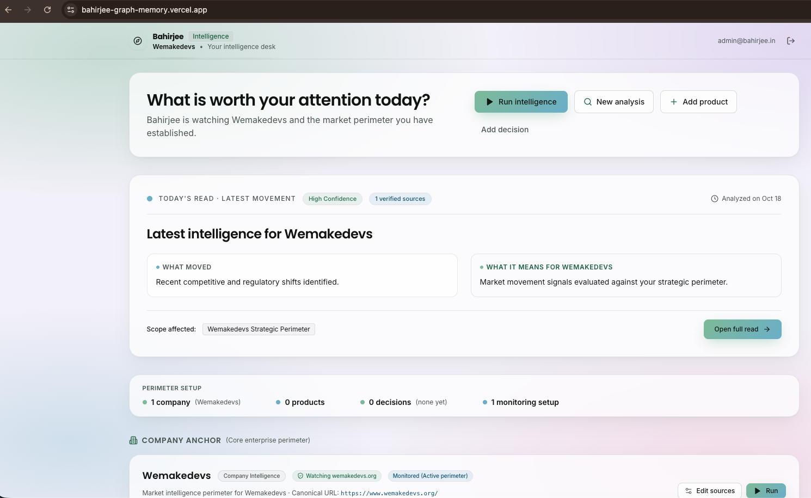
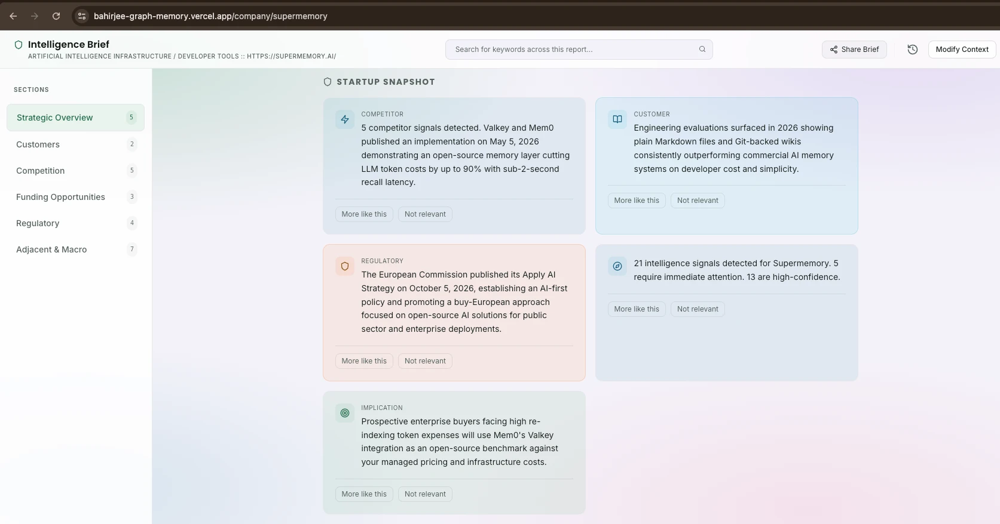
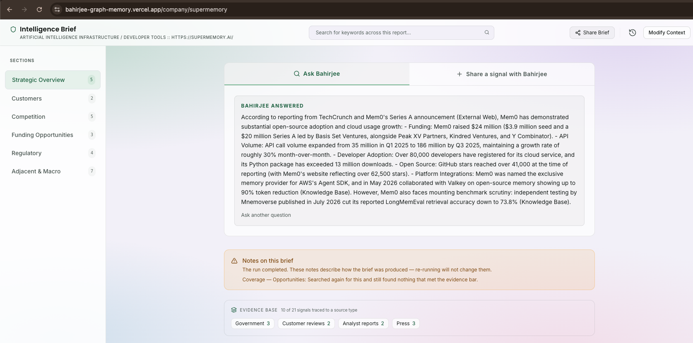
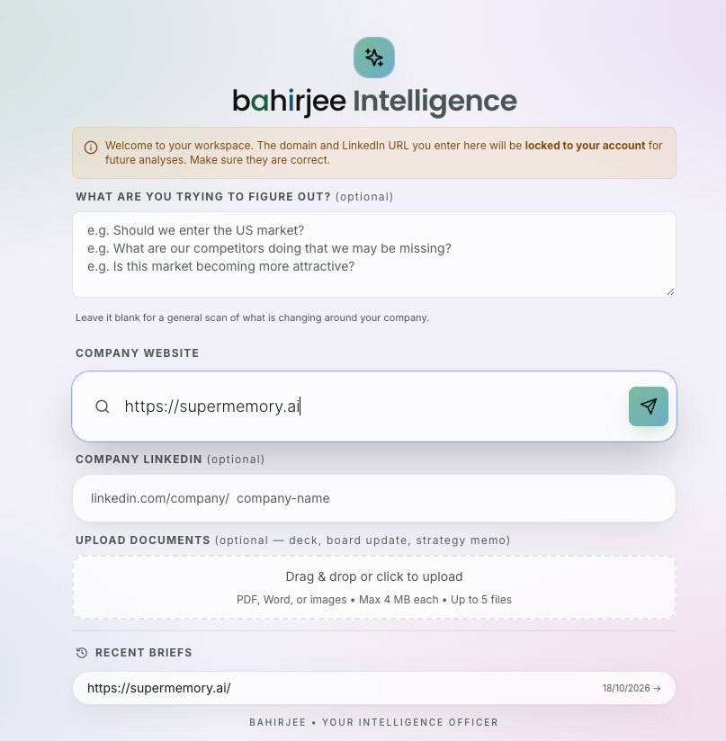
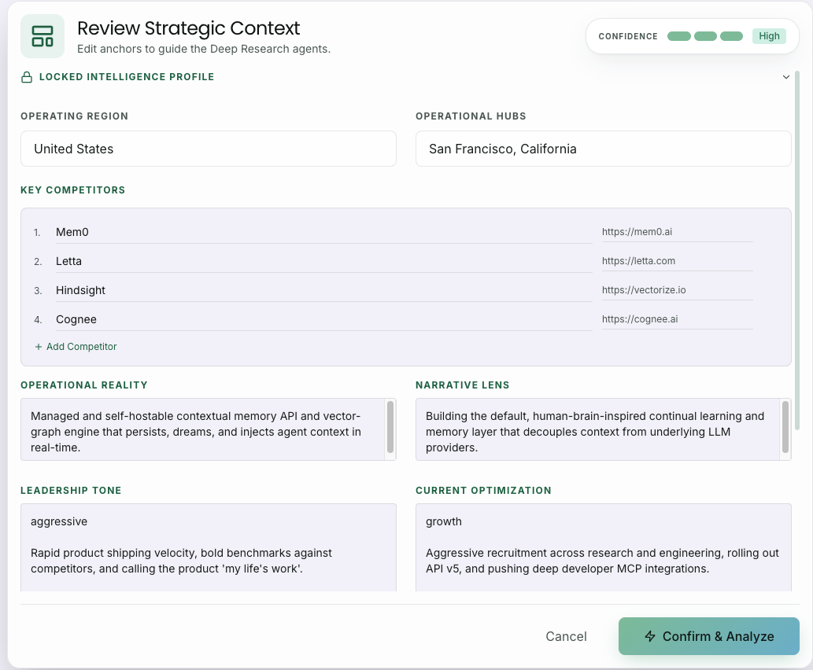
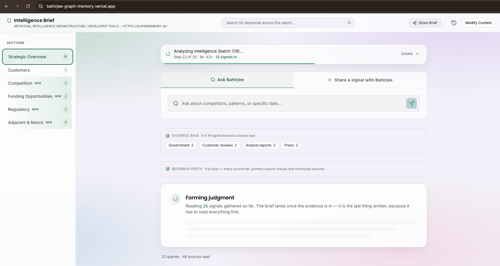
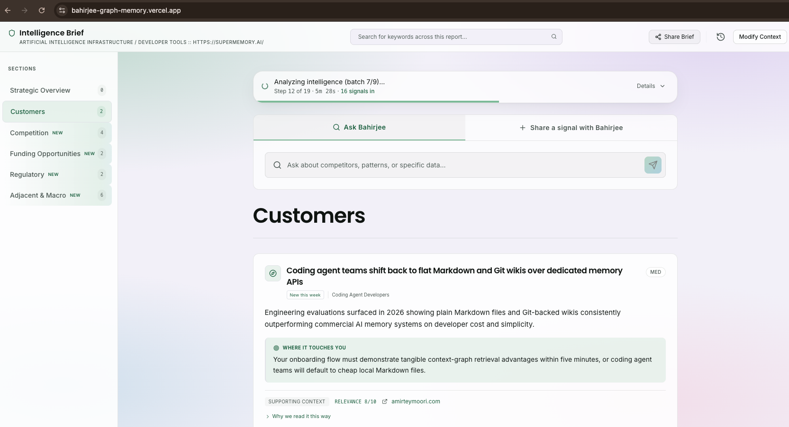
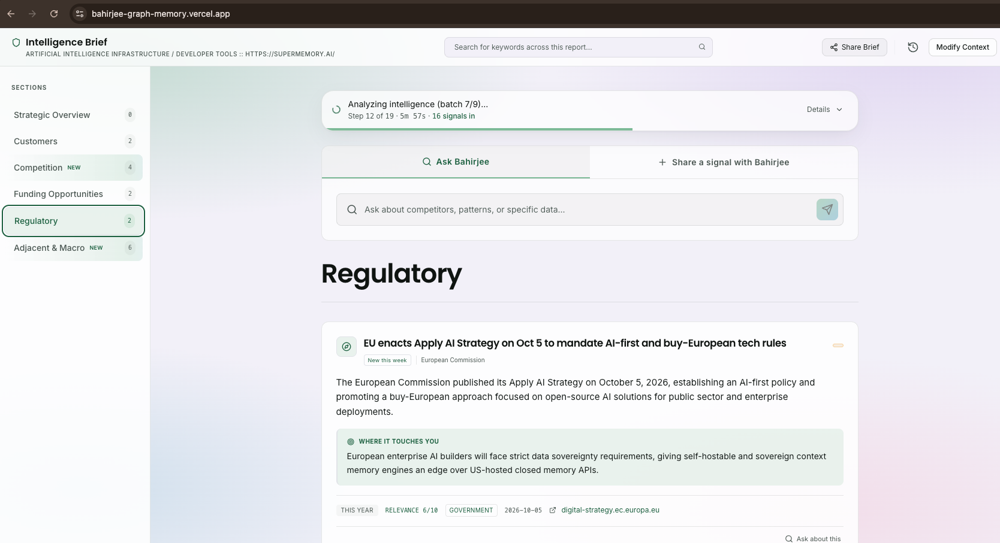

# Judge guide: check Bahirjee's memory graph in about 10 minutes

There are two ways to evaluate this submission. Pick one, or do both:

- **[A. The live app](#a-the-live-app-no-setup):** nothing to install. You check an analysis that already ran,
  ask the memory graph questions, add a new memory and recall it, and optionally start a new analysis.
- **[B. Graph only, on your machine](#b-graph-only-on-your-machine):** Docker, a Gemini key and
  three commands. This shows the same agent loop and Cypher in a terminal, plus the removal test.

What to look for in both: an answer that came **from the graph** ends with a provenance line like

```
[via memory graph — tool: blast_radius · path: AWS → Kubernetes → Acme Freight · memory as of 2026-10-18]
```

An answer **without** that line came from Bahirjee's older non-graph path (company context, then web
search). That happens on purpose when the graph has nothing connected to say. See step A3.

---

## A. The live app (no setup)

**URL:** https://bahirjee-graph-memory.vercel.app/
**Sign in:** type `admin@bahirjee.in` and press **Continue**. There is no password and no email to
click: this is the single demo account, and every judge shares it.

> The demo tenant's graph holds a synthetic company, **Acme Freight**, so the dependency questions
> below have real structure to traverse: a 4-deep chain Acme Freight → Kubernetes → AWS → Equinix
> DC-14 → State PowerGrid, a competitor (ShipSwift) that shares the AWS dependency, a pending agent
> handoff, and a deliberately disconnected Zendesk. The web analyses on the same account
> (WeMakeDevs and others) are real runs on public websites.

### A1. Check an analysis that already ran

1. The desk opens on **"What is worth your attention today?"** and a **Latest intelligence** card.

   

2. Click **Open full read**. This is the finished brief: confidence, *Notes on this brief* (how it was
   produced and what it couldn't verify), research depth, and the sections in the left rail.
   A brief opens on its **Startup snapshot**: the competitor, customer and regulatory signals the run
   published, each one traced to a source.

   

3. To see other past briefs, click the **clock icon** (top right of a brief), or open **New analysis**
   and look under **Recent briefs**.

### A2. Ask the memory graph

Every brief has an **Ask Bahirjee** box at the top. It asks the tenant graph first. Try these:

| Ask | Graph tool that runs | What you should see |
| :--- | :--- | :--- |
| `What breaks if AWS goes down?` | `blast_radius`: variable-length traversal over dependency edges | Everything connected to AWS, up to 4 hops away (Kubernetes, the company, ShipSwift, Equinix DC-14, …), with the paths |
| `How is ShipSwift connected to State PowerGrid?` | `path_between`: FalkorDB `algo.SPpaths` | ShipSwift → AWS → Equinix DC-14 → State PowerGrid |
| `What is load-bearing for us?` | `load_bearing`: FalkorDB `algo.pageRank` | Ranked entities, with State PowerGrid, Equinix and AWS at the top |
| `Who picks up the ShipSwift work next?` | `next_agent`: pending `Handoff` → `Agent` | A pending watcher → triage handoff about ShipSwift's pricing change |
| `What did we find about ShipSwift last time?` | `recall`, forced first because the question is about earlier work | The stored finding, answered from memory |

Each graph answer ends with the provenance line. The model only picks the tool and fills in typed
arguments. The Cypher is fixed and reviewed (`lib/_graphTools.js`).

**Two honest refusals.** These should *not* get a provenance line:

- `What do we know about Zorblax?`: the entity isn't in the graph. The tool returns `unknown_entity`
  without running any other query, and the app falls back to web search.
- `How is AWS connected to Zendesk?`: both entities are known but not connected. The tool returns
  `not_in_graph`, which says something about our coverage, not that the two are unrelated. The app
  then falls back.

### A3. Add a new memory, then recall it

This is the part of Track 2 that lasts across sessions.

1. Ask something the graph has no findings for, about an entity it does know. For example:
   `What is Delhivery's latest funding round?`
   No provenance line: the graph had nothing connected, so Bahirjee searched the web and answered.
   Such an answer looks like the one below, which answered a question about Mem0. The text names its
   sources, and there is no `[via memory graph …]` line at the end.

   

2. That answer was **written back** into the graph as a `Finding` linked `ABOUT` Delhivery
   (`/api/graph` `record_finding` → `graphWriteQaFinding` in `lib/_graphWriter.js`).
3. Start a fresh session: sign out (top right) and sign in again, or open the URL in a private window.
   Then ask: `What did we find about Delhivery last time?`
4. This time the answer comes from memory, with a provenance line naming `recall`. Nothing was
   re-searched.

### A4. Run a new analysis (optional, takes a few minutes)

1. On the desk, click **New analysis**.
2. Optionally fill in **What are you trying to figure out?** Enter a public **Company website**, for
   example `https://www.falkordb.com`, and send it with the arrow button. LinkedIn and document
   upload are optional; leave them empty. **Recent briefs** at the bottom lists earlier runs.

   

3. Bahirjee infers the company's context and shows it under **Review Strategic Context**: operating
   region, key competitors, operational reality and narrative lens. Edit anything that is wrong, then
   click **Confirm & Analyze**.

   

4. The run executes on the server. The progress bar shows *Step N of 19*, how long it has been
   running and how many signals are in, and you can close the tab without stopping it. The
   **Strategic Overview** waits for the judgment, which is written last.

   

   Other sections fill in as their signals arrive, each with *Where it touches you*, a relevance
   score and its source:

   <p>
     
     
   </p>

5. When it finishes, the brief opens. A completed run is also written to the tenant graph: the
   Company, the entities it tracks, an `analysis_run` Session, and one Finding per published signal
   (`lib/_graphRunWriter.js`). Ask `What did we find about <a competitor named in the brief>?` to
   recall them.

A run makes real search and LLM calls, so please run at most one or two.

---

## B. Graph only, on your machine

Requirements: Node 20+, Docker, a Gemini API key. No Supabase is needed.

```bash
git clone https://github.com/saurabhjambure-pixel/bahirjee-graph-memory.git
cd bahirjee-graph-memory
npm install
docker run -d -p 6379:6379 -p 3000:3000 falkordb/falkordb
```

Create `.env`:

```bash
FALKORDB_URL=falkor://localhost:6379
MEMORY_GRAPH_ENABLED=1
MEMORY_GRAPH_MAX_STEPS=4
GEMINI_API_KEY=your-gemini-key
INTERNAL_API_KEY=any-long-random-string
```

Seed the synthetic tenant and run the offline tests (19 checks, no network):

```bash
node --env-file=.env scripts/graph-seed.mjs
npm run test:graph
```

Ask the graph. This is the same loop `/api/graph` runs. Each run prints the outcome, the tool trace
and the paths:

```bash
node --env-file=.env scripts/graph-ask.mjs "What breaks if AWS goes down?"
node --env-file=.env scripts/graph-ask.mjs "How is Acme Freight connected to State PowerGrid?"
node --env-file=.env scripts/graph-ask.mjs "What is load-bearing for us?"
node --env-file=.env scripts/graph-ask.mjs "Who picks up the ShipSwift work next?"
node --env-file=.env scripts/graph-ask.mjs "What did we find about ShipSwift last time?"
node --env-file=.env scripts/graph-ask.mjs "What do we know about Zorblax?"
```

**Removal test.** Turn the graph off. The graph capabilities disappear and say so:

```bash
MEMORY_GRAPH_ENABLED=0 node --env-file=.env scripts/graph-ask.mjs "What breaks if AWS goes down?"
```

**See the graph.** Open FalkorDB Browser at http://localhost:3000, select graph
`bahirjee:00000000-0000-4000-8000-00000000000d`, and paste the queries from
[queries.cypher](./graph-hacks/queries.cypher) one at a time.

A tenant graph in FalkorDB Browser, after
`MATCH (n) OPTIONAL MATCH (n)-[e]-(m) RETURN * LIMIT 100`:


---

## Where to read further

- [README: graph data model and Cypher](../README.md#graph-hacks-submission--agent-memory--coordination-falkordb)
- [docs/graph-hacks/progress-log.md](./graph-hacks/progress-log.md): what was verified live, and the bugs it found
