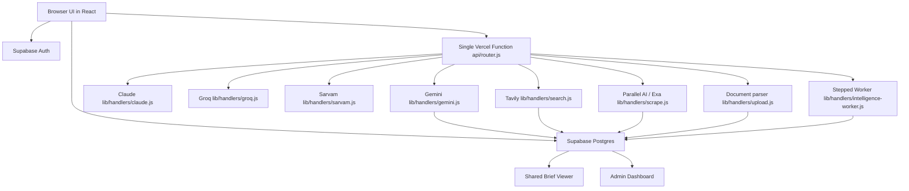

# Bahirjee Intelligence POC — Technical Documentation

> **Status: ARCHIVED HISTORICAL REFERENCE**
>
> This file is a historical comprehensive technical reference from the initial product build. While it contains useful structural context on data models and UI state machines, several sections describe superseded tools (such as DeepSeek and Firecrawl) and earlier monolithic assumptions.
>
> **For current production architecture, provider routing, and the stepped worker execution model, refer to [PROJECT_EXECUTION_BRIEF.md](./PROJECT_EXECUTION_BRIEF.md) and [the engineering notes](../the engineering notes).**

This document is a historical technical reference for the codebase at:

the repository root

It covers:

- What the app does end to end
- Which files own which features
- Where and how LLMs are called (multi-model)
- Which external tools/services are used
- How data moves through the system
- The full database schema

---

## 1. Product Summary

Bahirjee is an autonomous startup intelligence platform that:

- Authenticates users through Supabase
- Collects a target company website and optional LinkedIn / document inputs
- Builds an inferred company context using web scraping, search, and LLMs
- Runs an 11-step intelligence pipeline to extract verified signals, patterns, blind spots, and opportunities
- Saves the generated report to Supabase with persistent continuity memory across runs
- Exposes the result in an identity-gated shared brief viewer
- Enforces freemium limits and records interaction telemetry
- Provides an admin console for client management and intelligence execution

The product has two major user surfaces:

- Founder / analyst workflow
- Admin / operations workflow

---

## 2. High-Level Architecture



### Main runtime path

1. User signs in through Supabase.
2. User enters website, LinkedIn, and optional document upload.
3. Interactive context review allows founder to inspect/edit inferred context.
4. Analysis job is queued via `POST /api/intelligence` and executed by server-side worker (`POST /api/intelligence-worker`).
5. The pipeline scrapes primary sources, searches allowlisted source tiers, and analyzes signals using Gemini.
6. Synthesis engines (pattern, shift, opportunity, blind spot) run deterministically, followed by `gemini-2.5-pro` reasoning synthesis.
7. Generated context and signals are saved to Supabase with persistent memory.
8. The report is rendered in the workspace or shared viewer.

---

## 3. Tech Stack

### Frontend

- React 18
- React Router 7
- Tailwind CSS
- Lucide React icons
- react-hot-toast
- Vite 5
- PWA support through `vite-plugin-pwa`

### Backend / API

- Single Vercel Serverless Function (`api/router.js`) dispatching to `lib/handlers/*.js`
- Supabase client (service role for background workers)
- Tavily Search API (source tier allowlists with geo-routing)
- Parallel AI Extract API (primary scraper)
- Exa API (fallback scraper + neural search)
- Multi-model LLM gateway (Gemini Flash bulk tier, `gemini-2.5-pro` reasoning tier, Sarvam fallback)
- Upstash Redis for distributed sliding-window rate limiting

### Storage

- Supabase Auth (GoTrue)
- Supabase Postgres tables with RLS and pgvector extension
- Browser `localStorage` for lightweight UI preferences

## 4. Functional Flow

### 4.1 Authentication

Auth is handled by Supabase and wrapped in `src/context/AuthContext.jsx`.

Current behavior:

- Users sign in with an email-only magic-link flow.
- Profile data is loaded from `profiles` after auth changes.
- Admin users are redirected to `/admin`.

Key files:

- `src/context/AuthContext.jsx`
- `src/components/intelligence/AuthScreen.jsx`
- `src/components/IntelligenceDashboard.jsx`
- `src/components/ProtectedRoute.jsx`

### 4.2 Founder workflow

The founder path is:

1. Landing on `/`
2. Authentication
3. Intake screen for target website and optional inputs
4. Context-building phase
5. Startup intelligence profile onboarding
6. Context review
7. Signal generation / analysis
8. Final report workspace

Key screens:

- `src/components/intelligence/IntakeScreen.jsx`
- `src/components/intelligence/OnboardingScreen.jsx`
- `src/components/Onboarding/OnboardingForm.jsx`
- `src/components/intelligence/ContextReviewScreen.jsx`
- `src/components/intelligence/AnalyzingScreen.jsx`
- `src/components/intelligence/ErrorScreen.jsx`
- `src/components/intelligence/ReportWorkspace.jsx`
- `src/components/ReportViewer.jsx`

### 4.3 Shared report workflow

Shared reports are accessible at `/report/:shareToken`.

Behavior:

- The viewer loads the report by `share_token`
- It renders the same workspace layout in read-only mode
- It blocks access if the user is not authenticated
- It relies on the report's persisted row in Supabase

Key files:

- `src/components/ReportViewer.jsx`
- `src/services/reportService.js`
- `src/components/intelligence/ReportWorkspace.jsx`
- `src/App.jsx`

### 4.4 Freemium workflow

Freemium logic is implemented in both the client and database layers.

Client-side behavior:

- Free users can run one full analysis
- Free users can ask up to 3 questions and add up to 3 notes per report
- Locked sections 4+ are blurred for non-premium viewers
- Upgrade gates fire conversion telemetry

Server-side behavior:

- The database enforces the question/note limits through a trigger (`enforce_interaction_limits`)
- Interaction rows are persisted in the `interactions` table

Key files:

- `src/components/FreemiumGate.jsx`
- `src/components/Modals/PremiumUpgradeModal.jsx`
- `src/components/intelligence/StrategicInteractionHub.jsx`
- `src/components/intelligence/ReportWorkspace.jsx`
- `src/components/IntelligenceDashboard.jsx`
- `src/utils/premiumUtils.js`
- `schema.sql`

### 4.5 Admin workflow

Admin users can:

- View dashboard summaries
- Manage clients
- Manage users within a client
- Inspect system health
- See engagement telemetry from interactions

Key files:

- `src/pages/admin/AdminDashboard.jsx`
- `src/pages/admin/ClientList.jsx`
- `src/pages/admin/ClientDetail.jsx`
- `src/pages/admin/SystemHealth.jsx`
- `src/components/AdminLayout.jsx`
- `src/components/Admin/ComingSoon.jsx`

---

## 5. Multi-Model LLM Architecture

Bahirjee uses a **multi-provider LLM architecture** with automatic per-action routing and cascading fallback. No LLM is called directly from the frontend or services — all calls go through serverless API gateways (`lib/handlers/*.js`).

### 5.1 Provider overview

| Provider | Gateway | Primary actions | Role |
|----------|---------|----------------|------|
| **Gemini** | `lib/handlers/gemini.js` | Bulk analytical actions (Flash) & Reasoning synthesis (`gemini-2.5-pro`) | Primary provider across all stages |
| **Sarvam** | `lib/handlers/sarvam.js` | Cross-provider fallback | Inexpensive secondary fallback if Gemini fails |
| **Claude** | `lib/handlers/claude.js` | Vision recovery in `lib/_vision.js` (Haiku) | Wired, disabled by default for main pipeline |
| **Groq** | `lib/handlers/groq.js` | Wired but off by default | Configurable via `VITE_LLM_*` env vars |

### 5.2 LLM action map

| Action | Provider / Tier | Model | Purpose |
|--------|----------------|-------|---------|
| `buildContext` | Gemini (Bulk) | Gemini Flash | Builds inferred company context from scraped pages, LinkedIn, and uploaded docs |
| `mergeContext` | Gemini (Bulk) | Gemini Flash | Merges new source uploads into existing company context via quote-bound patch |
| `generateQueries` | Gemini (Bulk) | Gemini Flash | Generates targeted search queries when deterministic generation needs expansion |
| `analyzeSignals` | Gemini (Bulk) | Gemini Flash | Converts search observations into structured, grounded signals |
| `extractDocumentIntel`| Gemini (Bulk) | Gemini Flash | Quote-or-drop entity extraction from uploaded documents |
| `answerQuestion` | Gemini (Bulk) | Gemini Flash | Answers user Q&A against current context and verified signals |
| `interpretShifts` | Gemini (Reasoning) | `gemini-2.5-pro` | Performs deep judgment and strategic shift interpretation |
| `generateSummary` | Gemini (Reasoning) | `gemini-2.5-pro` | Produces executive summary for the founder brief |
| `generateDecisionBrief`| Gemini (Reasoning) | `gemini-2.5-pro` | Generates strategic decision options and risk considerations |
| `generateNewsLines` | Deterministic JS | None (`newsScorer.js`) | Zero-LLM scoring of news signals based on credibility and relevance |

### 5.3 Shared LLM utilities

**Gemini Gateway Model Tiers** (`lib/handlers/gemini.js`):
- Heavy: `gemini-3.8-flash` → `gemini-3.6-flash` → `gemini-3.5-flash-lite`
- Light: `gemini-3.5-flash-lite` → `gemini-3.8-flash`
- Reasoning: `gemini-3.1-pro-preview` → `gemini-3.8-flash` → `gemini-3.6-flash`

`lib/_llmUtils.js` provides common helpers for provider gateways:

- `parseProviderJSON()` — 5-strategy JSON repair pipeline with schema validation
- `fetchWithTimeout()` — Fetch wrapper with configurable abort timeouts
- `ModelFailureTracker` — Session-scoped per-model failure tracking
- `buildModelList()` — Builds ordered fallback model sequence
- `createOpenAICompatHandlers()` — Shared prompt and payload parser for OpenAI-compatible providers

### 5.4 Prompt ownership

All prompt templates and JSON schemas are centralized in `src/services/promptUtils.js`.
Prompt schemas enforce structured JSON outputs directly from the provider API.

Prompts defined:
- `buildContext`
- `buildQuery`
- `buildSignals`
- `buildSummary`
- `answerQuestion`

### 5.6 Serverless gateway conventions

Every LLM gateway (`api/gemini.js`, `api/deepseek.js`, `api/groq.js`, `api/sarvam.js`) shares:

- `applyApiSecurity()` guard from `api/_security.js`
- JSON repair and salvage (5 strategies via `parseProviderJSON`)
- Per-model failure tracking and automatic model fallback
- 45–57s timeout with Vercel deadline buffer
- 503 response if the provider is not configured (API key absent)

---

## 6. Intelligence Pipeline (v6.0)

The pipeline lives in `src/services/intelligenceService.js` and runs in phases:

#### Phase 1 — Context Building (`buildInitialContext`)
- Scrape target site via Parallel AI Extract / Exa
- Enrich with LinkedIn / public web data
- Call LLM with `buildContext` action → structured `Startup_Context`
- Generate entity watchlist via `entityWatchlistGenerator.js`
- Compute signal weights via `signalWeightEngine.js`
- Map primary tracking sources via `primarySourceMapper.js`
- Store context in `company_contexts` / `startup_contexts` table

### Phase 2 — Query Generation + Search
- Deterministic queries from `queryGenerator.js` (no LLM)
- LLM fallback via `generateQueries` action if needed
- Execute queries against Tavily (with source tier allowlists and geo-routing)
- Deep-read sources via Parallel AI Extract / Exa (fallback if content < 500 chars)
- Store raw observations in `observationService.js`

### Phase 3 — Signal Analysis (LLM)
- Analyze each source through `analyzeSignals` LLM action
- Grounding filter (`filterGroundedSignals`) verifies citations against fetched source batch
- Transform output via `structuredSignalTransformer.js`
- Weight signals via `signalWeightEngine.js`

### Phase 4 — Deterministic Analysis Engines (no LLM)
- **Pattern Engine** (`patternEngine.js`) — clusters observations by theme over a rolling 30-day window; computes source_diversity and velocity_score; assigns maturity: `early` / `forming` / `established`
- **Shift Engine** (`shiftEngine.js`) — detects emerging, structural, and anomaly shifts by comparing current vs. baseline patterns (thresholds: 2.5× velocity multiplier, ≥2 new source domains, >50% drop)
- **Opportunity Engine** (`opportunityEngine.js`) — detects buyer-intent opportunities (velocity > 2.0 + keyword match) and missed opportunities (competitor density ≥ 3, company absent)
- **Blind Spot Engine** (`blindSpotEngine.js`) — detects competitor presence without company presence in pattern observations

### Phase 5 — Synthesis + Summary (LLM)
- Shift interpretation performed on Gemini Reasoning tier (`gemini-2.5-pro`)
- Executive summary generated on Gemini Reasoning tier (`gemini-2.5-pro`)
- News scoring and curation via `newsScorer.js` (deterministic JS, zero LLM calls)

### Phase 6 — Attestation & Persistence
- Attestation checks in `briefPolicy.js` verify source citations, confidence ceilings, and advice guards
- Save full report to Supabase `reports` table
- Update `company_contexts` per `(client_id, target_domain)`
- Ingest vector embeddings into `document_chunks` (`ragService.js`)
- Update `brief_cards`, `brief_card_evidence`, and `company_memory_state` for continuity

**Estimated cost per run: ~$0.30–0.40**

---

## 7. Tooling by Function

### Supabase

Used for:

- Authentication (magic links + admin password)
- Postgres database (reports, observations, patterns, shifts, contexts, document_chunks)
- Row Level Security (RLS) enforcement
- Client isolation via `client_id` foreign keys
- pgvector semantic search for grounded Q&A

Relevant files:

- `src/lib/supabase.js`
- `schema.sql`
- `src/services/reportService.js`
- `src/services/companyContextService.js`
- `src/services/ragService.js`

### Tavily Search

Used for:

- Targeted market research queries
- Domain-allowlisted source tier queries (government, regional press, research, analyst, reviews)
- Primary competitor discovery

Relevant files:

- `lib/handlers/search.js`
- `src/services/sourceTiers.js`
- `src/services/intelligenceService.js`

### Parallel AI Extract / Exa

Used for:

- Primary web page and deep-read scraping (Parallel AI Extract)
- Secondary scraper fallback when text < 500 chars (Exa)
- Neural search for funding and competitor validation (Exa)

Relevant files:

- `lib/handlers/scrape.js`
- `lib/handlers/exa.js`
- `src/services/intelligenceService.js`

### LLM Providers

| Provider | Files | Role |
|---------|-------|------|
| Gemini | `lib/handlers/gemini.js` | Primary provider (Flash for bulk analytical work, `gemini-2.5-pro` for reasoning) |
| Claude | `lib/handlers/claude.js` | Wired; Claude Haiku active in `lib/_vision.js` for scanned PDF transcription |
| Groq | `lib/handlers/groq.js` | Wired, disabled by default |
| Sarvam | `lib/handlers/sarvam.js` | Cross-provider fallback |
| Shared utilities | `lib/_llmUtils.js` | Common JSON parsing, retry logic, timeout handling |
| Prompts | `src/services/promptUtils.js` | Prompt templates and JSON schemas |
| Orchestration | `src/services/intelligenceService.js` | Main pipeline orchestrator |

### Upstash Redis

Used for:

- Distributed sliding-window API rate limiting across Vercel serverless function invocations

Relevant files:

- `lib/_security.js`

### react-hot-toast

Used for:

- Admin and app notifications
- Success / error feedback

Relevant files:

- `src/App.jsx`
- `src/pages/admin/*.jsx`

### PWA support

Used for:

- Service worker registration
- Install prompt

Relevant files:

- `src/main.jsx`
- `src/components/PWA/InstallPrompt.jsx`
- `vite.config.js`

---

## 8. File-by-File Feature Map

### App bootstrap

- `src/main.jsx` — Mounts React, registers service worker
- `src/App.jsx` — Top-level routes, auth provider, toast container, admin route nesting, shared report route

### Auth and access

- `src/context/AuthContext.jsx` — Supabase session lifecycle, magic-link flow, admin detection, sign-out
- `src/context/ThemeContext.jsx` — Theme state management
- `src/components/intelligence/AuthScreen.jsx` — Login / magic-link UI, email-only auth form
- `src/components/ProtectedRoute.jsx` — Protects admin routes, enforces role-based access

### Core intelligence experience

- `src/components/IntelligenceDashboard.jsx` — Main founder dashboard controller; owns auth screen routing; owns intake → onboarding → review → analyzing → workspace phase state machine; calls context build and signal generation; saves reports and increments run count
- `src/components/intelligence/IntakeScreen.jsx` — Website / LinkedIn / file upload intake; generates initial context
- `src/components/intelligence/OnboardingScreen.jsx` — Wraps the onboarding form; allows reset back to idle
- `src/components/Onboarding/OnboardingForm.jsx` — Collects startup profile fields; handles sensitivity snapshot; captures strategic assumptions; shows auto-inferred values
- `src/components/intelligence/ContextReviewScreen.jsx` — Lets the user review and adjust inferred strategic context; allows confidence adjustment
- `src/components/intelligence/AnalyzingScreen.jsx` — Displays locked context and generation status while analysis runs
- `src/components/intelligence/ErrorScreen.jsx` — Retry and home recovery state
- `src/components/intelligence/ReportWorkspace.jsx` — Main report rendering surface; sidebar sections; share button; history panel; freemium lock gating; strategic interaction hub; v6 awareness surface; report-level cards and signal cards
- `src/components/ReportViewer.jsx` — Read-only shared report view; loads by `share_token`; renders workspace with viewer restrictions

### Intelligence interaction

- `src/components/intelligence/StrategicInteractionHub.jsx` — Ask Bahirjee Q&A; add note / share signal; freemium counters; persists interactions to Supabase
- `src/components/FreemiumGate.jsx` — Blurs locked sections for free users; fires upgrade telemetry; wraps premium-gated content
- `src/components/Modals/PremiumUpgradeModal.jsx` — Premium upgrade CTA modal
- `src/components/Modals/OnboardingModal.jsx` — Onboarding modal wrapper
- `src/components/Modals/CoffeeModal.jsx` — Coffee / support modal

### Intelligence visualization

- `src/components/StrategicAwarenessSurface.jsx` — Visualizes shifts, patterns, blind spots, and opportunities; supports reaction tracking
- `src/components/NewsThatMatters.jsx` — Shows exposure-weighted, curated news items; renders 3-line summary cards
- `src/components/intelligence/BahirjeeObservationHero.jsx` — Highlights the main observation at the top of the report
- `src/components/History/HistoryList.jsx` — Report history list panel

### Layout and navigation

- `src/components/Layout/MobileContainer.jsx` — Mobile-responsive layout wrapper
- `src/components/Layout/BottomNav.jsx` — Mobile bottom navigation bar
- `src/components/Home/ImageUploader.jsx` — Image upload UI component

### Color / palette tools

- `src/components/Palette/ColorCard.jsx` — Displays a color swatch card
- `src/components/Palette/PaletteResult.jsx` — Displays palette extraction results
- `src/lib/colorthief.js` — Color extraction from images
- `src/utils/colorUtils.js` — Color manipulation utilities

### Admin and operations

- `src/pages/admin/AdminDashboard.jsx` — Engagement telemetry overview; quick actions; summary cards
- `src/pages/admin/ClientList.jsx` — Create client organizations; search and browse clients
- `src/pages/admin/ClientDetail.jsx` — Create users for a client; activate / suspend / delete users; manage team members
- `src/pages/admin/SystemHealth.jsx` — System / pipeline health view
- `src/components/AdminLayout.jsx` — Admin shell and sidebar navigation
- `src/components/Admin/ComingSoon.jsx` — Placeholder for upcoming admin features

### Legal pages

- `src/pages/legal/PrivacyPolicy.jsx` — Privacy policy page
- `src/pages/legal/TermsOfService.jsx` — Terms of service page

### Supporting services

- `src/services/intelligenceService.js` — Pipeline orchestration; external API calls; LLM routing; report assembly
- `src/services/reportService.js` — Save and fetch reports; extract target domain; increment run counts; fetch by client/user/token
- `src/services/historyService.js` — Frontend wrapper around report history; delta and report lookup helpers
- `src/services/interactionService.js` — Tracks question, note, and conversion click interactions; summarizes engagement for admin analytics
- `src/services/observationService.js` — Stores raw search / scrape observations; builds company-level observation history
- `src/services/contextBuilder.js` — Converts onboarding + LLM inference into `Startup_Context`; derives exposure weights and dependency maps
- `src/services/queryGenerator.js` — Deterministic query generation from entities and signal weights
- `src/services/newsScorer.js` — Scores signals into "News That Matters"; generates LLM prompt for 3-line summaries
- `src/services/structuredSignalTransformer.js` — Converts LLM outputs into structured signals; stores structured signals
- `src/services/signalToShiftTransformer.js` — Client-side fallback to synthesize v6 shifts and opportunities
- `src/services/patternEngine.js` — Deterministic observation clustering by theme; velocity and maturity scoring (30-day rolling window)
- `src/services/shiftEngine.js` — Deterministic shift detection from pattern baselines (emerging / structural / anomaly)
- `src/services/opportunityEngine.js` — Deterministic opportunity detection via buyer-intent keywords and competitor density
- `src/services/blindSpotEngine.js` — Deterministic blind spot detection (competitor present, company absent in pattern)
- `src/services/entityWatchlistGenerator.js` — Derives structured entity watchlist from `Startup_Context` (infra / platform / regulator / competitor / industry_body); 10–40 entities
- `src/services/primarySourceMapper.js` — Maps tracked entities to primary tracking source URLs for deep-read prioritization
- `src/services/signalWeightEngine.js` — Computes signal category weights from exposure weights and revenue profile
- `src/services/companyMemoryService.js` — Persists and retrieves company-level memory state across pipeline runs; manages `brief_cards` deduplication and trend tracking
- `src/services/promptUtils.js` — Central prompt library for all LLM providers
- `src/services/impactService.js` — Tracks user reactions and impact events
- `src/services/memoryService.js` — Browser-side memory for repeated analyses and reactions

### Utilities

- `src/utils/premiumUtils.js` — `isPremiumOrExempt()`, `canCreateUnlimitedReports()`
- `src/utils/exportUtils.js` — Report export helpers
- `src/utils/haptics.js` — Mobile haptic feedback wrapper
- `src/utils/formatters.js` — Data formatting utilities
- `src/lib/supabase.js` — Supabase client initialization

### APIs

- `api/gemini.js` — Gemini router; JSON repair; action dispatch; universal LLM fallback
- `api/deepseek.js` — DeepSeek gateway; primary for context/signals/summary (reasoner + chat)
- `api/groq.js` — Groq gateway; primary for queries/news/Q&A (Llama 4 Scout, 3.3-70b, 3.1-8b)
- `api/sarvam.js` — Sarvam gateway; primary for context/signals/summary (105b, 30b with reasoning_effort)
- `api/_llmUtils.js` — Shared JSON parsing, model fallback tracking, OpenAI-compatible handler factory
- `api/search.js` — Tavily gateway with dual-key rotation
- `api/scrape.js` — Firecrawl / Exa scraping gateway
- `api/upload.js` — PDF/DOCX parsing (4 MB max)
- `api/auth-link.js` — Passwordless magic link generation
- `api/admin-users.js` — Admin CRUD for users
- `api/intelligence.js` — Admin-triggered intelligence run
- `api/_security.js` — CORS, origin checking, and rate limiting

---

## 9. Data Model

### Canonical schema file

`schema.sql`

### Tables

#### `waitlist`
Legacy waitlist table. Fields: `name`, `email`, `startup_url`, `country`.

#### `clients`
Organization records.
- `id` (uuid), `name`, `domain` (unique), `status` (active/inactive), `exempt_from_freemium`
- Domain-based auto-join: new users are matched to a client by their email domain.

#### `profiles`
User records linked to `auth.users`.
- `role` (admin / client_user), `client_id`, `is_active`, `is_premium`, `run_count`
- RLS: users can view/update own profile; admins bypass via `is_admin()`.

#### `reports`
Generated intelligence briefs.
- `context` (jsonb), `signals` (jsonb), `brief` (jsonb)
- `memory_state` (jsonb) — persisted cross-run memory
- `card_summary` (jsonb) — summary of active brief cards
- `share_token` (uuid, unique), `target_domain`
- `is_current_snapshot`, `superseded_by_report_id` — snapshot chain for history
- `based_on_report_id` — links to prior run
- Indexed by `(client_id, effective_at desc)` and `(client_id, target_domain, effective_at desc)`

#### `startup_contexts`
Versioned onboarding + LLM-inferred context per company.
- `revenue_profile`, `market_profile`, `dependency_map`, `competitive_map`
- `strategic_assumptions`, `exposure_weights`, `sensitivity_snapshot`
- `onboarding_inputs`, `auto_inferred`
- Versioned by `version_id`; indexed by `(company_id, created_at desc)`.

#### `brief_cards`
Persistent, deduplicated signal/shift/opportunity/blindspot cards.
- `card_key` (unique per company), `section_key`, `card_type` (intro/signal/shift/blindspot/opportunity/memory)
- `status` (active/dormant/resolved), `trend_state` (new/recurring/strengthening/weakened/resolved)
- `occurrence_count`, `first_seen_at`, `last_seen_at`
- Linked to `first_seen_report_id` and `last_seen_report_id`

#### `brief_card_evidence`
Evidence records linking brief cards to source signals and reports.
- `card_id`, `report_id`, `signal_index`, `source_url`, `evidence_type`, `evidence_excerpt`

#### `company_memory_state`
One row per company. Cross-run state for persistent intelligence.
- `latest_report_id`, `latest_context_version_id`
- `memory_state`, `current_brief`, `current_cards`, `active_sections`
- `run_count`

#### `interactions`
Q&A / note / conversion click tracking.
- `interaction_type` (question / note / conversion_click)
- Enforced 3+3 limit for free users via `enforce_interaction_limits` trigger

#### `email_allowlist`
Email-level access control for individual exceptions (e.g. personal emails).
- `email` (primary key), `client_id`, `role`, `is_active`

### Database functions and triggers

| Name | Purpose |
|------|---------|
| `is_admin()` | Returns `true` if current user has `role = 'admin'`; used in RLS policies |
| `enforce_interaction_limits` | Trigger on `interactions` INSERT; blocks free users beyond 3 questions + 3 notes per report |
| `handle_new_user` | Trigger on `auth.users` INSERT; auto-creates profile and matches client by email domain or allowlist |

### RLS

RLS is enabled on all tables. The `is_admin()` helper grants admins full access. Client users can only read/write rows scoped to their `client_id`. Domain-based sharing is supported on `reports` via email domain matching against `target_domain`.

---

## 10. Key Limits and Business Rules

### Freemium limits

- Free users can run one full analysis
- Free users can ask up to 3 questions per report
- Free users can add up to 3 notes per report
- Locked report sections start at section 4
- `clients.exempt_from_freemium = true` bypasses all limits
- Helper: `isPremiumOrExempt(profile)` in `src/utils/premiumUtils.js`

### Shared report rules

- Shared brief access is token-based via `share_token`
- The viewer loads the exact persisted report row
- Access is additionally gated by Supabase RLS and email-domain matching

### Admin rule

- Admin users are detected through `profiles.role = 'admin'`
- Admin pages are protected by `src/components/ProtectedRoute.jsx`
- Seed admin: `admin@bahirjee.ai` (password randomized at seed time; use magic link or dashboard to gain access)

---

## 11. Environment Variables

```bash
# ── LLM Providers ──────────────────────────────────────────────────────────

# Gemini (Required — universal fallback for all LLM actions)
GEMINI_API_KEY=...
# GEMINI_MODEL=gemini-3.8-flash   # optional heavy-tier lead; also GEMINI_LIGHT_MODEL, GEMINI_REASONING_MODEL

# DeepSeek (Optional — primary for buildContext, generateQueries, analyzeSignals, generateSummary, interpretShifts)
# DEEPSEEK_API_KEY=...
# DEEPSEEK_MODEL=deepseek-chat    # optional override; default: deepseek-reasoner → deepseek-chat

# Groq (Optional — primary for generateQueries, interpretShifts, generateNewsLines, answerQuestion)
# GROQ_API_KEY=...
# GROQ_MODEL=llama-3.3-70b-versatile   # optional override; per-action defaults used if not set

# Sarvam (Optional — primary for buildContext, analyzeSignals, generateSummary)
# SARVAM_API_KEY=...
# SARVAM_MODEL=sarvam-105b   # optional override; default: sarvam-105b → sarvam-30b

# ── Prompt size controls (server-side, cost/quota tuning) ──────────────────
# PROMPT_CONTEXT_CHAR_LIMIT=60000
# PROMPT_SIGNALS_CHAR_LIMIT=120000
# PROMPT_SUMMARY_CHAR_LIMIT=50000

# ── Search and Scraping ────────────────────────────────────────────────────
FIRECRAWL_API_KEY=...
TAVILY_API_KEY=...          # supports comma-separated dual key: key1,key2

# ── Supabase (Frontend) ────────────────────────────────────────────────────
VITE_SUPABASE_URL=...
VITE_SUPABASE_ANON_KEY=...

# ── Supabase (Server-side admin) ───────────────────────────────────────────
SUPABASE_URL=...
SUPABASE_SERVICE_ROLE_KEY=...

# ── API Config ─────────────────────────────────────────────────────────────
# SITE_URL=https://bahirjee-poc.vercel.app     # optional; auto-injected by Vercel
# ALLOWED_ORIGINS=https://bahirjee-poc.vercel.app,http://localhost:5173
# API_RATE_LIMIT_MAX=60
# API_RATE_LIMIT_WINDOW_MS=60000
# KV_REST_API_URL=...      # Upstash Redis (optional; falls back to in-memory)
# KV_REST_API_TOKEN=...

# ── Frontend (Vite) ────────────────────────────────────────────────────────
# VITE_API_BASE_URL=http://localhost:3000
# VITE_CONTEXT_INPUT_CHAR_LIMIT=60000
```

---

## 12. Local Development

```bash
npm run dev           # Vite dev server on :5173 (frontend + API proxy via vercel-proxy.js)
npm run dev:vercel    # Vercel CLI dev on :3000 (real serverless emulation — use for API work)
npm run build         # Production build → dist/
npm run preview       # Preview production build
```

The custom Vite plugin `vercelApiProxy()` in `vercel-proxy.js` intercepts `/api/*` calls during `npm run dev` to emulate Vercel functions locally.

---

## 13. Operational Notes

### Source of truth

- UI state is mostly in React
- Durable analysis data is in Supabase
- The analysis is a mix of deterministic transforms (Phases 2–4) and LLM-generated output (Phases 1, 3, 5)

### Deterministic vs LLM-backed logic

**Deterministic (no LLM):**
- First-pass query generation
- Observation clustering (patternEngine)
- Shift detection (shiftEngine)
- Opportunity detection (opportunityEngine)
- Blind spot detection (blindSpotEngine)
- Signal weighting (signalWeightEngine)
- Entity watchlist generation (entityWatchlistGenerator)
- News scoring (newsScorer)
- Shift synthesis fallback (signalToShiftTransformer)

**LLM-backed:**
- Context building
- Query generation fallback
- Signal analysis
- Summary generation
- Shift interpretation
- User Q&A
- 3-line news summaries

### API security

Every API route must call `applyApiSecurity()` before handling requests:

```javascript
import { applyApiSecurity } from './_security.js'

export default async function handler(req, res) {
  const securityResult = await applyApiSecurity(req, res, { rateLimit: 30 })
  if (securityResult.blocked) return
  // ... handler logic
}
```

### Styling

**Light claymorphism on a soft aurora wash.** (Replaced the original dark-only theme.)

```css
--bah-bg: #f4f2f9                      /* aurora base — 60% */
--bah-panel: rgba(255,255,255,0.72)    /* translucent glass card — 30% */
--bah-accent: #88c2a2                  /* sage FILL only — 1.84:1, never text */
--bah-accent-text: #1f6b49             /* sage for TEXT — 5.8:1 on base */
--bah-radius-sm: 8px / --bah-radius-lg: 20px
```

The accent is split deliberately: `#88c2a2` fails WCAG AA as text, so it is a
fill/border colour and `.text-bah-accent` resolves to `--bah-accent-text`. Never
hardcode a hex or use raw `slate-*`/`white/*` scales — they bypass the token layer.
Verify colour changes with `scripts/contrastAudit.js` (must report 0 failures).

Use `clsx` + `tailwind-merge` for conditional classes.

---

## 14. Suggested Reading Order

If you want to understand the app quickly, read in this order:

1. `src/App.jsx`
2. `src/components/IntelligenceDashboard.jsx`
3. `src/services/intelligenceService.js`
4. `src/services/promptUtils.js`
5. `api/gemini.js` → `api/_llmUtils.js` → `api/deepseek.js` / `api/groq.js` / `api/sarvam.js`
6. `src/services/patternEngine.js` → `shiftEngine.js` → `opportunityEngine.js` → `blindSpotEngine.js`
7. `src/components/ReportViewer.jsx`
8. `src/components/intelligence/ReportWorkspace.jsx`
9. `src/pages/admin/AdminDashboard.jsx`
10. `schema.sql`

---

## 15. Summary

This project is a full-stack intelligence platform with:

- Supabase-backed auth, storage, and RLS
- A multi-stage AI pipeline with 4 deterministic analysis engines
- Multi-model LLM support (Gemini / DeepSeek / Groq / Sarvam) with per-action routing and cascading fallback
- Web scraping and search orchestration with dual-key Tavily rotation
- Persistent company memory across runs (brief cards with trend tracking)
- Shared report delivery
- Freemium enforcement
- Admin telemetry and client management

The most important orchestration point is `src/services/intelligenceService.js`. The LLM gateway is distributed across `api/gemini.js`, `api/deepseek.js`, `api/groq.js`, and `api/sarvam.js`, with shared utilities in `api/_llmUtils.js`.
